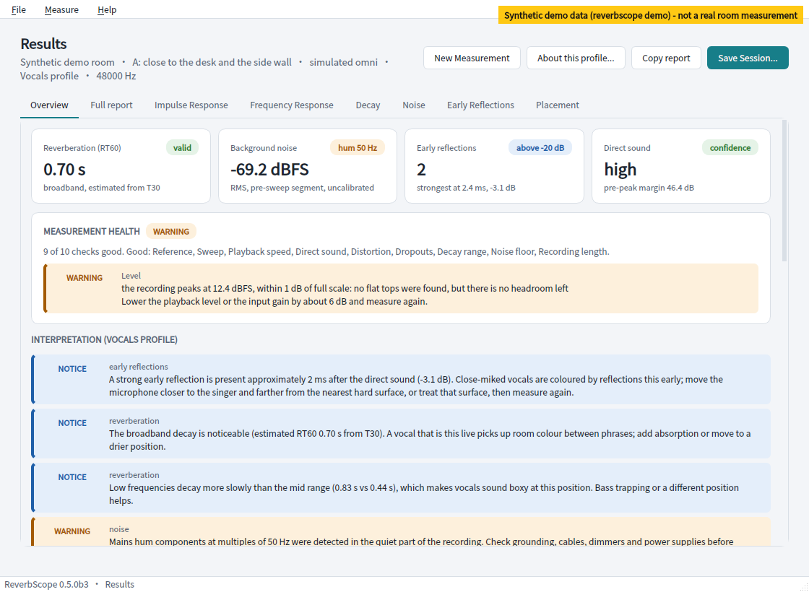
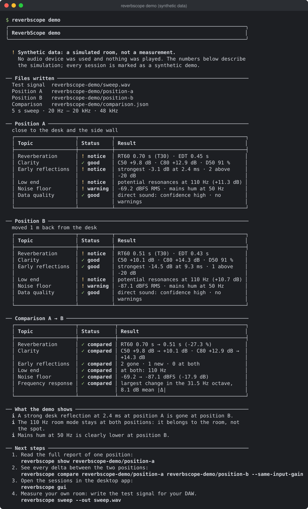

**English** | [简体中文](README.zh-CN.md)

# ReverbScope

Offline acoustic room-measurement desktop app and command line. Plays a sine
sweep, derives the room impulse response and reports RT60/EDT/T20/T30,
C50/C80/D50, early reflections, background noise and frequency response, each
with a validity flag. English and 简体中文. 离线房间声学测量工具。Pre-release.

**Pre-release software, built by one student developer.** The analysis,
the desktop workstation and the command line are in place and covered by
automated tests on Linux, macOS and Windows. **Nothing has been measured
through a real audio interface or DAW yet**, so treat every number as
unvalidated. [Help test it](#help-test-it).

[](https://github.com/jingyemingyue/ReverbScope/releases)
[](https://github.com/jingyemingyue/ReverbScope/actions/workflows/ci.yml)
[](LICENSE)



<sub>The desktop workstation of 0.5.0b6 (light theme) on the built-in simulated
room. Synthetic demo data: no real room was measured.</sub>

**New in 0.5.0b6** ([changelog](CHANGELOG.md)):

* **A new look.** A light, warm window with a sidebar (New Measurement, Open
  Project, Open Session, your measurements and saved sessions). The dark theme
  stays.
* **Safer playback.** The sweep plays only on an audio-interface output you
  choose; Start stays off until you pick one.
* **A leaner tool.** The 3D room view is gone: ReverbScope is a measurement
  tool, and the placement figures now sit in the inspector.
* **A truer level warning.** A recording that peaks above 0 dBFS now says how
  far above full scale it is, in English and 简体中文, instead of "within 1 dB".

> ⚠️ **Unsigned builds.** ReverbScope is not notarized by Apple and carries no Windows Authenticode signature. Your system will warn on first launch — this is expected. See [Download](#download) for the manual allow steps. You do NOT need to disable Gatekeeper or SmartScreen.

> ⚠️ **未签名说明**：本应用未经过 Apple 公证，也没有 Windows Authenticode 签名，首次启动时系统会弹出警告，属正常现象。请按 [Download](#download) 一节的步骤手动允许，无需关闭 Gatekeeper 或 SmartScreen。
## Download

### **[→ Download from GitHub Releases](https://github.com/jingyemingyue/ReverbScope/releases)**

**What is public today (2026-10-17):** [v0.5.0b1](https://github.com/jingyemingyue/ReverbScope/releases/tag/v0.5.0b1),
published under the old **RoomScope** name. Use its `RoomScope` assets and
`roomscope demo` (nothing is played); exact file names, checksums and first
launch are in the [public-beta guide](docs/PUBLIC_TESTING.md).

**Not public yet:** the renamed `v0.5.0rc2` and `v0.5.0b3` builds are Draft
releases that visitors cannot download, and 0.5.0b6 has no Release yet. No
stable 0.5.0, signed or notarized build, or PyPI package exists. The tables below name the renamed builds; they
become download instructions when an accepted pre-release is published.

### 🖥 Desktop Edition

For most people: the workstation window with charts, plus the `reverbscope`
command line.

| Platform | Download | Architecture | Notes |
| --- | --- | --- | --- |
| **macOS** 14+ | [`ReverbScope-Desktop-macOS-arm64.dmg`](https://github.com/jingyemingyue/ReverbScope/releases) | Apple silicon (M1 or later) | Open the DMG, drag **ReverbScope** to **Applications** |
| **macOS** 14+ | [`ReverbScope-Desktop-macOS-x86_64.dmg`](https://github.com/jingyemingyue/ReverbScope/releases) | Intel | Same as above |
| **Windows** 10 / 11 | [`ReverbScope-Desktop-Windows-x64-Setup.exe`](https://github.com/jingyemingyue/ReverbScope/releases) | x64 | Installer; then Start menu → **ReverbScope** |
| **Windows** 10 / 11 | [`ReverbScope-Desktop-Windows-x64.zip`](https://github.com/jingyemingyue/ReverbScope/releases) | x64 | No installer: extract, double-click **`reverbscope-gui.exe`** |
| **Linux** (glibc 2.39+) | [`ReverbScope-Desktop-Linux-x86_64.tar.gz`](https://github.com/jingyemingyue/ReverbScope/releases) | x86_64 | Extract, run `reverbscope/reverbscope-gui` |

**First launch.** The builds are unsigned (not notarized by Apple, no Windows
Authenticode signature), so the system warns once:

* **macOS:** click **Done**, then **System Settings → Privacy & Security →
  Open Anyway**. You do not need to turn off Gatekeeper or System Integrity
  Protection.
* **Windows:** SmartScreen → **More info → Run anyway**.

Not sure which Mac you have? Apple menu → **About This Mac**: *Chip: Apple M…*
means Apple silicon, *Processor: Intel* means Intel.

### ⌨️ Terminal Edition

For scripts, automation, servers and computers without a desktop: the same
measurement and analysis without the window, about half the size.

| Platform | Download | Architecture | Command |
| --- | --- | --- | --- |
| **macOS** 14+ | [`ReverbScope-Terminal-macOS-arm64.tar.gz`](https://github.com/jingyemingyue/ReverbScope/releases) | arm64 (Apple silicon) | `reverbscope-terminal/reverbscope demo` |
| **macOS** 14+ | [`ReverbScope-Terminal-macOS-x86_64.tar.gz`](https://github.com/jingyemingyue/ReverbScope/releases) | x86_64 (Intel) | `reverbscope-terminal/reverbscope demo` |
| **Windows** 10 / 11 | [`ReverbScope-Terminal-Windows-x64.zip`](https://github.com/jingyemingyue/ReverbScope/releases) | x64 | Open **`ReverbScope Terminal.cmd`**, then `reverbscope.exe demo` |
| **Linux** (glibc 2.39+) | [`ReverbScope-Terminal-Linux-x86_64.tar.gz`](https://github.com/jingyemingyue/ReverbScope/releases) | x86_64 | `reverbscope-terminal/reverbscope demo` |

Extract the archive first (`tar xzf <file>`; on Windows **Extract All…**). On
macOS, if a downloaded `reverbscope` is refused, run
`xattr -dr com.apple.quarantine reverbscope-terminal` once: it clears the
download mark on those files only and does not turn off Gatekeeper.

### Which one?

| | Desktop Edition | Terminal Edition |
| --- | --- | --- |
| Workstation window with charts | ✅ | — |
| Command line (`reverbscope`) | ✅ | ✅ |
| Room analysis and comparison | ✅ | ✅ |
| Measuring through an audio interface (plays and records) | ✅ | ✅ |
| English / 简体中文 | ✅ | ✅ |
| Python required | No | No |
| Best for | Most users | Automation, lightweight or headless computers |

Not sure? Take the **Desktop Edition**: it contains the command line too.
Install, checksums (`SHA256SUMS`), updating and uninstalling:
**[Installation guide](docs/INSTALLATION.md)** ([简体中文](docs/INSTALLATION.zh-CN.md)).

## Try the demo

No microphone and no audio interface needed; nothing is played. In a terminal:

```bash
reverbscope demo
```

The downloads do not put `reverbscope` on your `PATH`. Open the terminal in
the folder that holds it (the Windows installer:
`%LOCALAPPDATA%\Programs\ReverbScope`) or give its full path (macOS Desktop
Edition: `/Applications/ReverbScope.app/Contents/MacOS/ReverbScope demo`).



`reverbscope demo` simulates one room at two microphone positions, runs the
real analysis and comparison on them and says what to do next. Every number it
shows describes the simulation, and every session it saves is marked as a
synthetic demo. The desktop app has no demo button; open that saved session
with **Session…** to see the workstation on the same data.

**Then measure for real.** Turn the monitors **down** (ReverbScope never
changes system volume), then let ReverbScope play and record through your
interface, or play its sweep in your DAW and import the recording. Both are
one **New Measurement** page. The [user guide](docs/user-guide/en.md)
([简体中文](docs/user-guide/zh-CN.md)) explains every page.

## Using the desktop app

1. **Start.** Open ReverbScope (Desktop Edition, [Download](#download)). On the
   first start the middle of the window offers the two ways to play and record
   the sweep: through the audio interface, or in your DAW. **Help ▸ Getting started** brings that
   card back.
2. **See a result first.** Run `reverbscope demo` once (above), then choose
   **Open Session…** in the sidebar and pick `position-a` in the demo folder.
   Everything you see is the simulated room.
3. **Measure.** Turn the monitors down, then choose **New Measurement**. At
   the top of the page, choose how the sweep is played and recorded; the
   details, the recording profile and the analysis under it are the same
   either way.
   * *Play and record through the audio interface:* pick the input, the output, the sample rate and the
     microphone channel in the strip at the bottom, then **Start**. The sweep
     plays only on an interface output you chose; until you do, Start stays
     off and says why. Above −12 dBFS the level is confirmed again after any
     level change.
   * *Play it in your DAW and import the recording:* generate the test signal at your project's sample rate,
     play and record it in your DAW, export the recorded track whole, then
     **Choose Recording…** and **Choose Reference Sweep…** and analyze.
4. **Read it.** The view bar opens Overview, Frequency, Time, Decay, Spectral
   and Report. The inspector on the right opens with the measurement health:
   what was found, what it affects and what to do next. A number marked not
   valid is shown in brackets and is not to be trusted.
5. **Compare and keep.** Right-click a measurement in the list to use it as the
   baseline, then open **Compare**. **Project** collects the positions of one
   room. A take that is not saved is marked *unsaved*, and ReverbScope asks
   before it is dropped.

The same steps from a terminal are in [Command line](#command-line).

## What it does

ReverbScope answers the questions a recording engineer asks before pressing
record:

* Is this room usable for recording, and what is wrong with it (strong early
  reflections, long decay, low-frequency build-up, mains hum, a high noise
  floor)?
* Is this position usable for a vocal, a drum room mic or a choir?
* Did moving the microphone or the performer improve things?

It measures with an exponential sine sweep, derives the impulse response by
deconvolution and reports EDT / T20 / T30 and an estimated RT60, early and
late energy (C50, C80, D50, centre time), frequency response, background
noise, early reflections and possible low-frequency resonances.

**The desktop workstation** keeps everything in one window:

* A **navigator** lists the open project's positions and every open
  measurement, each with a colour and a tick to overlay it on the charts.
* **Views** for the overview, frequency response, impulse response and energy
  decay, noise, spectrogram and waterfall, a comparison against a baseline
  and the full report.
* An **inspector** with the measurement's health, key figures with trust
  chips, the selected reflection and, with tape measurements, the placement
  figures.
* **Interactive charts**: zoom about the cursor, pan, exact axis limits, a
  readout with units under the pointer, export to image or CSV.
* A **measure strip** at the bottom: mode, interface, rate, channels, position,
  Start and Stop. Light and dark themes; English and 简体中文.

**What it refuses to do.** Every number carries its unit, its algorithm source
and a validity flag. When the data is not good enough, ReverbScope says
*"Insufficient decay range"* instead of inventing a figure. There is
deliberately no room score and no 3D room model: ReverbScope is a measurement
tool. One omnidirectional microphone measures path lengths, not directions,
so the placement figures say only what two tape measurements and the early
reflections *constrain* and never name a wall. A recording profile (vocal, voiceover,
acoustic guitar, drums, room mic, choir) may add one notice when C50 or C80 is
a poor fit; that threshold is an engineering choice, not a grade.

A sourced comparison with REW, Open Sound Meter, ARTA, Smaart and others, and
when another tool is the better choice, is in
[docs/COMPARISON.md](docs/COMPARISON.md).

## Status

The version on `main` is **0.5.0b6**; `release/0.5.0` carries the release
candidate. The analysis core, command line, desktop workstation, comparison,
loopback, Simplified Chinese catalog, session bundles and both editions'
bundles exist and are tested with synthetic data on Linux, macOS and Windows.

**Not yet:** any result measured on real hardware (the hardware matrix and the
validation campaign are empty), any DAW run, signed or notarized bundles, a PyPI
package. No build meets the 0.5.0 gate of the [release plan](docs/RELEASE_PLAN.md).
What works, dated: [docs/STATUS.md](docs/STATUS.md). What comes next:
[docs/ROADMAP.md](docs/ROADMAP.md).

## Help test it

The most useful thing anyone can do now is run it on a real interface or in a
real DAW and report what happened. A failed check is as useful as a pass.

1. Install a build ([Download](#download); the Gatekeeper or SmartScreen
   warning is expected). Start with the [public beta](docs/PUBLIC_TESTING.md).
2. In a terminal, run `reverbscope demo` once to see what a result looks like.
3. Turn the monitors down, then measure through your interface with a
   microphone, or play the sweep in your DAW and import the recording
   ([DAW notes](docs/user-guide/daw-setup.md)).
4. Report what happened, with **Help → Environment Report for Bug Reports →
   Probe sample rates** pasted in:
   * [Audio interface test report](https://github.com/jingyemingyue/ReverbScope/issues/new?template=hardware.yml):
     device list, takes at 44.1 / 48 / 96 kHz, channels above 2, loopback,
     Stop during playback, dropouts, unplugging during a take;
   * [DAW compatibility report](https://github.com/jingyemingyue/ReverbScope/issues/new?template=daw.yml):
     the same sweep recorded and exported through one DAW.

The short [test guide](docs/COMMUNITY_TESTING.md)
([中文](docs/COMMUNITY_TESTING.zh-CN.md)) says exactly what to run. Results go
into [docs/HARDWARE_TESTS.md](docs/HARDWARE_TESTS.md) with a link to your
report; only runs on a physical interface count there. Small first
contributions are listed in [docs/COMMUNITY_TASKS.md](docs/COMMUNITY_TASKS.md).

## How a measurement works

**In your DAW, then import the recording.** This works with any DAW that can import, play, record and
export WAV files. ReverbScope never talks to the DAW: it reads what the DAW
exports (Broadcast WAV, RF64, Wave64, AIFF, CAF, FLAC; 16/24/32-bit PCM or
32-bit float; mono or multi-channel) and, when the sweep's sidecar file is
used, names the usual cause when the sweep was played at the wrong speed.
Step-by-step notes, written from each vendor's documentation, cover Pro Tools,
Logic Pro / GarageBand, Cubase / Nuendo, Fender Studio Pro (Studio One),
Ableton Live, REAPER, FL Studio, Bitwig, Digital Performer and Audacity:
[docs/user-guide/daw-setup.md](docs/user-guide/daw-setup.md). **None of them
has been run with ReverbScope in a real DAW yet.**

1. **Generate Test Signal**: a sweep WAV plus a small JSON sidecar.
2. **Record Through Your DAW**: import the WAV, play it through your
   interface and monitors, record the measurement microphone on another track.
3. **Import Recording**: export the recorded track as WAV.
4. **Analyze**: ReverbScope finds the sweep, deconvolves it and reports.

**Through the audio interface.** ReverbScope plays the sweep and records the microphone itself through
the interface you select (PortAudio via `sounddevice`). The default sweep
level is conservative and ReverbScope does not touch system volume or audio
settings (the one opt-in exception, a macOS option that sets the device's
sample rate, is described in [SECURITY.md](SECURITY.md#safety-when-measuring-through-an-audio-interface)).

Both ways call the same analysis pipeline (`reverbscope.core.pipeline.analyze`).
Without an audio device or PortAudio, importing a recording still works.

## Command line

Both editions include the command line: `reverbscope` in the Terminal Edition,
next to `reverbscope-gui` in the Windows and Linux Desktop Edition and in a
Python install; in the macOS Desktop Edition it is
`/Applications/ReverbScope.app/Contents/MacOS/ReverbScope`.

```bash
# Generate the test signal, play it through your DAW, record, then analyze
reverbscope sweep --out sweep_48k.wav
reverbscope analyze --recording recording.wav --sweep sweep_48k.wav --out results/

# Two tape measurements unlock the vertical geometry; a profile tunes the advice
reverbscope analyze --recording recording.wav --sweep sweep_48k.wav \
  --speaker-distance 1.65 --mic-height 0.40 --temperature 21
reverbscope analyze --recording recording.wav --sweep sweep_48k.wav --profile voiceover

# Re-open a saved session, compare two positions
reverbscope show results/
reverbscope compare results/ position-b/ --same-input-gain

# Through the audio interface: list devices, then measure
reverbscope devices
reverbscope measure --out session1/ --input-device 2 --output-device 3 \
  --input-channels 1,2 --loopback-channel 2 --sample-rate 48000

# Several positions of one room
reverbscope project init --out room/ --name Booth
reverbscope project add room/ session1/ --position desk
reverbscope project overview room/   # health, fit, verdicts, next steps per position

# No interface needed
reverbscope demo --out demo/
reverbscope profiles vocal           # what a recording profile watches for

# The desktop workstation (Desktop Edition, or a Python install with the gui extra)
reverbscope gui
```

A result folder holds `result.json` (all metrics and curves),
`impulse_response.wav` (raw IR, float32), `session.json`, the sweep's sidecar
and a copy of the recording. The recording you pass in is never modified.
Every option, the language and style settings, CSV and bundle export are in the
[user guide](docs/user-guide/en.md).

## Documentation

| Document | Content |
| --- | --- |
| [docs/INSTALLATION.md](docs/INSTALLATION.md) | Install on macOS, Windows, Linux or with Python; unsigned-build warnings, troubleshooting; [中文](docs/INSTALLATION.zh-CN.md) |
| [docs/user-guide/en.md](docs/user-guide/en.md) | User guide: install, measure, read, compare, bundle; [简体中文](docs/user-guide/zh-CN.md) |
| [docs/user-guide/daw-setup.md](docs/user-guide/daw-setup.md) | Step-by-step DAW notes; [中文](docs/user-guide/daw-setup.zh-CN.md) |
| [docs/MEASUREMENT_METHODOLOGY.md](docs/MEASUREMENT_METHODOLOGY.md) | Algorithms, units, validity rules, references |
| [docs/STATUS.md](docs/STATUS.md) | Implemented, tested, known limits, next milestone |
| [docs/HARDWARE_TESTS.md](docs/HARDWARE_TESTS.md) | The hardware and DAW test matrix, still empty; [中文](docs/HARDWARE_TESTS.zh-CN.md) |
| [docs/COMPARISON.md](docs/COMPARISON.md) | How ReverbScope differs from REW, ARTA, Smaart and others; [中文](docs/COMPARISON.zh-CN.md) |
| [docs/AUDIO_DEVICES.md](docs/AUDIO_DEVICES.md) | Host APIs and how devices are probed and chosen; [中文](docs/AUDIO_DEVICES.zh-CN.md) |
| [docs/COMPATIBILITY.md](docs/COMPATIBILITY.md) | Platforms, DAW export formats, host APIs and what verified each; [中文](docs/COMPATIBILITY.zh-CN.md) |
| [docs/EDITIONS.md](docs/EDITIONS.md) | Desktop vs. Terminal Edition; [中文](docs/EDITIONS.zh-CN.md) |
| [docs/ARCHITECTURE.md](docs/ARCHITECTURE.md) | Package layout, data flow, extension points |
| [docs/DEPENDENCIES.md](docs/DEPENDENCIES.md) | Every dependency with license and purpose |
| [docs/LICENSE_DECISION.md](docs/LICENSE_DECISION.md) | Why ReverbScope is Apache-2.0 |
| [docs/index.md](docs/index.md) | The full documentation hub |

## Development install

For contributors. Python 3.12 or newer; ReverbScope is not on PyPI yet, so
install from a clone:

```bash
git clone https://github.com/jingyemingyue/ReverbScope.git
cd ReverbScope
python3.12 -m venv .venv && source .venv/bin/activate   # Windows: .venv\Scripts\activate
pip install -e ".[dev,gui]"
reverbscope --help
reverbscope gui
```

Each release also carries a wheel (`reverbscope-<version>-py3-none-any.whl`)
and a source archive; see [Installation → Python](docs/INSTALLATION.md#python-wheel-and-source).
`scripts/build_release.py` builds both editions of the current platform
locally ([RELEASE_PLAN.md](docs/RELEASE_PLAN.md) §3a).

## Technical architecture

### Python API

```python
from reverbscope import analyze, compare, interpret_comparison
from reverbscope.io.wav import read_wav, load_reference
from reverbscope.core import Reference

recording = read_wav("recording.wav")
reference = load_reference("sweep_48k.wav")  # uses the JSON sidecar if present
result = analyze(recording, reference)
print(result.decay.broadband.rt60_estimate_s, result.decay.broadband.rt60_basis)
for r in result.reflections.reflections:
    print(f"{r.delay_ms:.1f} ms  {r.relative_db:.1f} dB")
```

### Design principles

* **DAW-independent**: no DAW SDKs, ever. WAV in, WAV out.
* **Core-first**: DSP functions are pure NumPy/SciPy functions with no GUI,
  device or file-format dependencies, so a CLI, a desktop app, a plug-in or a
  Python API can share them.
* **Scientific correctness over features**: algorithms come from published
  papers and standards (Farina 2000, Schroeder 1965, Lundeby 1995,
  ISO 3382-1/-2); see [docs/MEASUREMENT_METHODOLOGY.md](docs/MEASUREMENT_METHODOLOGY.md).
* **Honest numbers**: dBFS unless calibrated, a validity flag on every metric,
  no pseudo-scientific room score.
* **Measurement health on every result**: the checks made on the take itself
  (sweep, playback speed, direct sound, level, distortion, dropouts, decay
  range, noise floor, recording length), each good, warning, invalid or
  unknown with the reason and what to do next.
* **Several positions, one overview**: a project folder collects the takes of
  a room by microphone position and says per position what to measure next,
  without ranking.
* **Clean-room implementation**: no third-party source is vendored
  ([docs/CODE_PROVENANCE.md](docs/CODE_PROVENANCE.md)); every dependency and
  reference repository is audited ([docs/THIRD_PARTY_REVIEW.md](docs/THIRD_PARTY_REVIEW.md)).

## Contributing

Pull requests are welcome once you have run the checks in
[CONTRIBUTING.md](CONTRIBUTING.md). Please also read the
[code of conduct](CODE_OF_CONDUCT.md). Useful starting points:

* [docs/ARCHITECTURE.md](docs/ARCHITECTURE.md): package layout and the one
  analysis entry point
* [docs/MEASUREMENT_METHODOLOGY.md](docs/MEASUREMENT_METHODOLOGY.md): every
  metric's algorithm, units and validity rules
* `examples/synthetic_measurement.py`: an end-to-end run with no hardware

```bash
pytest
ruff check . && ruff format --check .
mypy
```

CI (pytest on Ubuntu 3.12–3.14 plus macOS and Windows 3.12, ruff, mypy,
sdist/wheel) runs on every push and pull request.

## License

Apache License 2.0. See [LICENSE](LICENSE) and [NOTICE](NOTICE).
