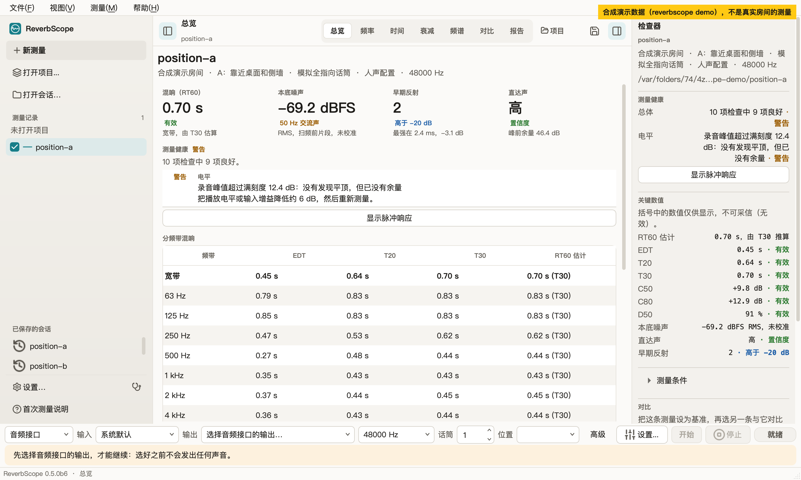
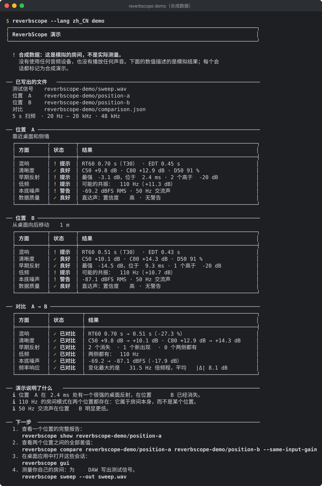

[English](README.md) | **简体中文**

# ReverbScope

离线房间声学测量桌面应用与命令行工具。播放正弦扫频，解算出房间脉冲响应，
报告 RT60/EDT/T20/T30、C50/C80/D50、早期反射、本底噪声与频率响应，每项都带有效性标记。
支持 English 与简体中文。预发布版。

**预发布软件，由一名学生开发者独立开发。** 分析核心、桌面工作台和命令行都已完成，并在 Linux、macOS、
Windows 上通过了自动化测试。**但还没有任何一次测量经过真实音频接口或 DAW**，所以请把所有数值当作
尚未验证的结果。[参与测试](#参与测试)。

[](https://github.com/jingyemingyue/ReverbScope/releases)
[](https://github.com/jingyemingyue/ReverbScope/actions/workflows/ci.yml)
[](LICENSE)



<sub>0.5.0b6 的桌面工作台（浅色主题），使用内置的模拟房间。合成演示数据，没有测量真实房间。</sub>

**0.5.0b6 的新内容**（[更新日志](CHANGELOG.md)）：

* **全新外观。** 浅色、偏暖的窗口，带侧栏（新测量、打开项目、打开会话、你的测量记录和已保存的会话）。深色主题保留。
* **更安全的播放。** 扫频只会从你选定的音频接口输出播放；选定之前，“开始”保持不可用。
* **更精简的工具。** 三维房间视图已移除：ReverbScope 是测量工具，摆位数值现在放在检查器里。
* **更准确的电平警告。** 录音峰值超过 0 dBFS 时，现在会说明超出满刻度多少（中英文都是），而不再说“距满刻度不到 1 dB”。

> 本文是 [README.md](README.md) 的简体中文版本；两者不一致时，以英文版为准。

## 下载

### **[→ 从 GitHub Releases 下载](https://github.com/jingyemingyue/ReverbScope/releases)**

**截至 2026-10-17 已公开：** [v0.5.0b1](https://github.com/jingyemingyue/ReverbScope/releases/tag/v0.5.0b1)，
沿用旧名 **RoomScope**。请下载该版本的 `RoomScope` 文件，使用 `roomscope demo`（不会播放声音）。
[公开 beta 安装指南](docs/PUBLIC_TESTING.zh-CN.md) 提供各平台准确的文件名、校验和与首次启动步骤。

**尚未公开：** 更名后的 `v0.5.0rc2` 和 `v0.5.0b3` 都是 Draft，未登录的访客无法下载，0.5.0b6 还没有 Release。
目前没有 0.5.0 稳定版、已签名或已公证的构建，也没有 PyPI 包。下面的表格对应更名后的构建，等维护者公开一个通过验收的预发布版本后，
才成为下载说明。

### 🖥 桌面版（Desktop Edition）

适合绝大多数用户：带工作台窗口和图表的应用程序，同时包含 `reverbscope` 命令行。

| 平台 | 下载 | 架构 | 说明 |
| --- | --- | --- | --- |
| **macOS** 14+ | [`ReverbScope-Desktop-macOS-arm64.dmg`](https://github.com/jingyemingyue/ReverbScope/releases) | Apple 芯片（M1 及更新），优先 | 打开 DMG，把 **ReverbScope** 拖到 **Applications（应用程序）** |
| **macOS** 14+ | [`ReverbScope-Desktop-macOS-x86_64.dmg`](https://github.com/jingyemingyue/ReverbScope/releases) | Intel，仍会构建 | 同上 |
| **Linux**（glibc 2.39+） | [`ReverbScope-Desktop-Linux-x86_64.tar.gz`](https://github.com/jingyemingyue/ReverbScope/releases) | x86_64 | 解压后运行 `reverbscope/reverbscope-gui` |

**Windows。** 源码仍在仓库里，CI 仍会跑 Windows 测试。新版本**不再提供官方 Windows 安装程序或 zip**（没有 Authenticode 签名的官方安装包），也不把 Windows 图形界面当成已支持的下载。本地构建仍可能生成 `reverbscope-gui.exe`，它不是 Release 资产。自行从源码安装不等于硬件或界面验收。

**第一次打开（macOS）。** 构建未经 Apple 公证，系统可能警告一次：点 **完成**，再到 **系统设置 → 隐私与安全性 → 仍要打开**。不需要关闭 Gatekeeper 或系统完整性保护（SIP）。

不确定是哪种 Mac？苹果菜单 → **关于本机**：显示 *芯片 Apple M…* 的是 Apple 芯片，显示 *处理器 Intel* 的是 Intel。

### ⌨️ 终端版（Terminal Edition）

适合脚本和自动化、服务器以及没有图形桌面的电脑：同样的测量和分析，没有窗口，体积约为桌面版的一半。

| 平台 | 下载 | 架构 | 命令 |
| --- | --- | --- | --- |
| **macOS** 14+ | [`ReverbScope-Terminal-macOS-arm64.tar.gz`](https://github.com/jingyemingyue/ReverbScope/releases) | arm64（Apple 芯片） | `reverbscope-terminal/reverbscope demo` |
| **macOS** 14+ | [`ReverbScope-Terminal-macOS-x86_64.tar.gz`](https://github.com/jingyemingyue/ReverbScope/releases) | x86_64（Intel） | `reverbscope-terminal/reverbscope demo` |
| **Linux**（glibc 2.39+） | [`ReverbScope-Terminal-Linux-x86_64.tar.gz`](https://github.com/jingyemingyue/ReverbScope/releases) | x86_64 | `reverbscope-terminal/reverbscope demo` |

先解压（`tar xzf <文件>`）。没有官方 Windows 终端版 zip。在 macOS 上，如果系统拒绝运行下载来的 `reverbscope`，
请运行一次 `xattr -dr com.apple.quarantine reverbscope-terminal`：它只清除这些文件上的下载标记，不会关闭 Gatekeeper。

### 该选哪个？

| | 桌面版 | 终端版 |
| --- | --- | --- |
| 带图表的工作台窗口 | ✅ | — |
| 命令行（`reverbscope`） | ✅ | ✅ |
| 房间分析与对比 | ✅ | ✅ |
| 独立模式测量（播放并录音） | ✅ | ✅ |
| English / 简体中文 | ✅ | ✅ |
| 需要 Python | 不需要 | 不需要 |
| 适合 | 大多数用户 | 自动化、轻量或无图形界面的电脑 |

拿不准？选**桌面版**：它也包含命令行。分步安装、校验和（`SHA256SUMS`）、更新和卸载：
**[安装指南](docs/INSTALLATION.zh-CN.md)**（[English](docs/INSTALLATION.md)）。

## 先试试演示

不需要话筒和音频接口，也不会播放任何声音。在终端中运行：

```bash
reverbscope config language zh_CN   # 以后一直使用中文界面（只需运行一次）
reverbscope demo
```

ReverbScope 本来就跟随系统语言（Mac 的首选语言、Windows 的显示语言、Linux 的 `LANGUAGE` / `LANG`）；
保存后不管系统怎么设置都使用中文，`reverbscope config language auto` 改回跟随系统。

下载的安装包不会把 `reverbscope` 加入 `PATH`：请在它所在的文件夹里打开终端（Windows 安装程序：
`%LOCALAPPDATA%\Programs\ReverbScope`），或者写出它的完整路径（macOS 桌面版：
`/Applications/ReverbScope.app/Contents/MacOS/ReverbScope demo`）。



`reverbscope demo` 会模拟一个房间里的两个话筒位置，用真实的分析和对比流程处理它们，并告诉你下一步做什么。
它显示的每个数值都描述的是模拟结果，保存的每个会话都标记为合成演示。桌面版没有演示按钮：用 **会话…**
打开保存下来的那个会话，就能在同样的数据上看到工作台。

**然后进行真实测量：** 先把监听音箱音量**调低**（ReverbScope 不会改动系统音量），然后二选一：让 ReverbScope
通过你的音频接口自己播放并录音（**独立模式**），或者在 DAW 中播放它的扫频（**通用 DAW 模式**）。
[用户指南](docs/user-guide/zh-CN.md)（[English](docs/user-guide/en.md)）逐页说明各项功能。

## 桌面应用怎么用

1. **启动。** 打开 ReverbScope（桌面版，见[下载](#下载)）。第一次启动时，窗口中间会给出三个入口：演示、DAW 路线和独立模式路线。
   **帮助 ▸ 首次测量说明** 可以把这张卡片调回来。
2. **先看一个结果。** 先运行一次 `reverbscope demo`（见上文），再点侧栏的 **打开会话…**，选演示文件夹里的 `position-a`。
   你看到的一切都来自模拟房间。
3. **测量。** 先把监听音箱音量调低，再点 **新测量**。
   * *音频接口：* 在底部的测量条里选输入、输出、采样率和话筒声道，然后点 **开始**。扫频只会从你选定的接口输出播放；
     选定之前“开始”保持不可用，并说明原因。电平高于 −12 dBFS 时，改动电平之后要再确认一次。
   * *DAW 录音：* 按工程采样率生成测试信号，在 DAW 里播放并录音，把录好的轨道完整导出，然后点
     **选择录音…** 和 **选择参考扫频…**，再分析。
4. **读结果。** 视图栏可以打开总览、频率、时间、衰减、频谱和报告。右边的检查器先显示测量健康度：
   发现了什么、影响哪些数值、下一步该做什么。标记为无效的数值会放在括号里，不要采信。
5. **对比与保存。** 在列表里右键一条测量，把它设为基准，再打开 **对比**。**项目** 把同一个房间的各个位置放在一起。
   没有保存的录音会标为 *未保存*，丢弃之前 ReverbScope 会先询问。

同样的步骤在终端里怎么做，见[命令行](#命令行)。

## 它能做什么

ReverbScope 回答录音师按下录音键之前会问的问题：

* 这个房间能不能用来录音？问题出在哪里（强早期反射、衰减过长、低频堆积、电源哼声、本底噪声过高）？
* 这个位置适合录人声、鼓的房间话筒，还是合唱？
* 挪动话筒或演奏者之后，情况有没有改善？

它用指数正弦扫频测量房间，通过解卷积得到脉冲响应，并报告 EDT / T20 / T30 和估算的 RT60、早期与后期能量
（C50、C80、D50、重心时间）、频率响应、本底噪声、早期反射以及可能存在的低频共振。

**桌面工作台**把一切放在一个窗口里：

* **导航栏**列出打开的工程里的各个位置和每一次测量，每项有自己的颜色，勾选即可叠加到图表上。
* **多个视图**：概览、频率响应、脉冲响应与能量衰减、噪声、声谱图与瀑布图、与基准的对比，以及完整报告。
* **检查器**显示这次测量的健康度、带可信标记的关键数值、选中的反射，以及有卷尺实测时的摆位数值。
* **可交互的图表**：以光标为中心缩放、平移、精确设置坐标轴范围、指针下带单位的读数，可导出为图片或 CSV。
* 底部的**测量条**：模式、接口、采样率、声道、位置、开始和停止。浅色和深色主题，英文和简体中文。

**它不会做什么。** 每个数字都带有单位、算法来源和有效性标记。数据质量不够时，ReverbScope 会给出
*“衰减范围不足”*（*Insufficient decay range*），而不是编造一个数字。ReverbScope 有意不提供任何“房间评分”，也不提供三维房间模型：它是测量工具。
一支全向话筒测到的是路程长度而不是方向，所以摆位数值只说明两次卷尺实测加早期反射*能约束*什么，从不指认某一面墙。
录音配置（人声、旁白、民谣吉他、鼓、房间话筒、合唱）可能在 C50 或 C80 不适合该类录音时给出一条提示；
阈值是工程上的选择，不是评分。

与 REW、Open Sound Meter、ARTA、Smaart 等工具的有出处的对比，以及什么时候该用别的工具，见
[docs/COMPARISON.zh-CN.md](docs/COMPARISON.zh-CN.md)。

## 当前状态

`main` 上的版本是 **0.5.0b6**；`release/0.5.0` 是候选版线。分析核心、命令行、桌面工作台、对比、回采（loopback）、
简体中文文案、会话打包以及两个版本的安装包都已存在，并用合成数据在 Linux、macOS、Windows 上测试过。

**还没有：** 任何在真实硬件上测得的结果（硬件矩阵和硬件验证都还是空的）、任何 DAW 的实际运行、
已签名或已公证的安装包、PyPI 包。目前没有任何构建达到[发布计划](docs/RELEASE_PLAN.zh-CN.md)里 0.5.0 的门槛。
已经做了什么（带日期）：[docs/STATUS.md](docs/STATUS.md)。接下来做什么：[docs/ROADMAP.zh-CN.md](docs/ROADMAP.zh-CN.md)。

## 参与测试

现在最有用的事，是在真实的音频接口或真实的 DAW 上跑一遍，然后告诉我发生了什么。失败的检查和通过的一样有用。

1. 安装一个构建（[下载](#下载)；出现 Gatekeeper 或 SmartScreen 警告是正常的）。先从[公开 beta](docs/PUBLIC_TESTING.zh-CN.md) 开始。
2. 在终端里运行一次 `reverbscope demo`，看看结果是什么样。
3. 把音箱音量调低，然后用你的接口和话筒运行**独立模式**，或者通过 DAW 运行**通用 DAW 模式**
   （[DAW 说明](docs/user-guide/daw-setup.zh-CN.md)）。
4. 报告发生了什么，并贴上 **帮助 → 用于错误报告的环境信息 → 探测采样率** 的输出：
   * [音频接口测试报告](https://github.com/jingyemingyue/ReverbScope/issues/new?template=hardware-zh-CN.yml)：
     设备列表、44.1 / 48 / 96 kHz 的完整测量、2 个以上声道、回采、播放中按停止、掉帧、测量中拔线；
   * [DAW 兼容性报告](https://github.com/jingyemingyue/ReverbScope/issues/new?template=daw-zh-CN.yml)：
     同一段扫频通过某个 DAW 录制并导出。

简短的[测试指南](docs/COMMUNITY_TESTING.zh-CN.md)写明了具体要跑什么。结果会连同你的报告链接记录到
[docs/HARDWARE_TESTS.zh-CN.md](docs/HARDWARE_TESTS.zh-CN.md)，只有在实体接口上跑出来的才算数。
适合第一次贡献的小任务列在 [docs/COMMUNITY_TASKS.md](docs/COMMUNITY_TASKS.md)。

## 测量是怎么进行的

**通用 DAW 模式**适用于任何能导入、播放、录音并导出 WAV 的 DAW。ReverbScope 从不与 DAW 通信：它读取 DAW 导出的文件
（Broadcast WAV、RF64、Wave64、AIFF、CAF、FLAC；16/24/32 位 PCM 或 32 位浮点；单声道或多声道），并且在使用扫频
附带的 sidecar 文件时，指出扫频被以错误速度播放的常见原因。依据各厂商文档写成的分步说明覆盖 Pro Tools、
Logic Pro / GarageBand、Cubase / Nuendo、Fender Studio Pro（Studio One）、Ableton Live、REAPER、FL Studio、
Bitwig、Digital Performer 和 Audacity：[docs/user-guide/daw-setup.zh-CN.md](docs/user-guide/daw-setup.zh-CN.md)。
**这些 DAW 还没有一个真的和 ReverbScope 一起跑过。**

1. **生成测试信号**：一个扫频 WAV，加一个小的 JSON sidecar。
2. **通过 DAW 录音**：导入这个 WAV，经你的接口和音箱播放，把测量话筒录到另一条轨道上。
3. **导入录音**：把录好的轨道导出为 WAV。
4. **分析**：ReverbScope 找到扫频、解卷积并给出报告。

**独立模式**由 ReverbScope 自己通过你选择的接口播放扫频并录下话筒（通过 `sounddevice` 使用 PortAudio）。默认扫频电平
偏保守，ReverbScope 不会改动系统音量或音频设置（唯一的可选例外，是一个设置设备采样率的 macOS 选项，见
[SECURITY.zh-CN.md](SECURITY.zh-CN.md)）。

两种模式调用同一条分析管线（`reverbscope.core.pipeline.analyze`）。

## 命令行

两个版本都带命令行：终端版里是 `reverbscope`；Windows 和 Linux 的桌面版里它在 `reverbscope-gui` 旁边；
Python 安装里也有；macOS 桌面版里是 `/Applications/ReverbScope.app/Contents/MacOS/ReverbScope`。

```bash
# 生成测试信号，用 DAW 播放并录音，然后分析
reverbscope sweep --out sweep_48k.wav
reverbscope analyze --recording recording.wav --sweep sweep_48k.wav --out results/

# 两个卷尺量出的距离可以解锁垂直几何；配置会调整建议的措辞
reverbscope analyze --recording recording.wav --sweep sweep_48k.wav \
  --speaker-distance 1.65 --mic-height 0.40 --temperature 21
reverbscope analyze --recording recording.wav --sweep sweep_48k.wav --profile voiceover

# 重新打开已保存的会话，对比两个位置
reverbscope show results/
reverbscope compare results/ position-b/ --same-input-gain

# 独立模式：列出设备，然后测量
reverbscope devices
reverbscope measure --out session1/ --input-device 2 --output-device 3 \
  --input-channels 1,2 --loopback-channel 2 --sample-rate 48000

# 同一个房间的多个位置
reverbscope project init --out room/ --name Booth
reverbscope project add room/ session1/ --position desk
reverbscope project overview room/   # 每个位置的健康度、适配度、结论和下一步

# 不需要接口
reverbscope demo --out demo/
reverbscope profiles vocal           # 某个录音配置关注什么

# 桌面工作台（桌面版，或安装了 gui 额外依赖的 Python 安装）
reverbscope gui
```

结果文件夹里有 `result.json`（所有指标和曲线）、`impulse_response.wav`（原始脉冲响应，float32）、`session.json`、
扫频的 sidecar，以及一份录音的副本。你传入的录音永远不会被修改。全部选项、语言和样式设置、CSV 与打包导出见
[用户指南](docs/user-guide/zh-CN.md)。

## 文档

| 文档 | 内容 |
| --- | --- |
| [docs/INSTALLATION.zh-CN.md](docs/INSTALLATION.zh-CN.md) | 在 macOS、Windows、Linux 或用 Python 安装；未签名构建的警告、故障排查；[English](docs/INSTALLATION.md) |
| [docs/user-guide/zh-CN.md](docs/user-guide/zh-CN.md) | 用户指南：安装、测量、读结果、对比、打包；[English](docs/user-guide/en.md) |
| [docs/user-guide/daw-setup.zh-CN.md](docs/user-guide/daw-setup.zh-CN.md) | 各 DAW 的分步说明；[English](docs/user-guide/daw-setup.md) |
| [docs/MEASUREMENT_METHODOLOGY.md](docs/MEASUREMENT_METHODOLOGY.md) | 算法、单位、有效性规则、参考文献（英文） |
| [docs/STATUS.md](docs/STATUS.md) | 已实现、已测试、已知限制、下一个里程碑（英文） |
| [docs/HARDWARE_TESTS.zh-CN.md](docs/HARDWARE_TESTS.zh-CN.md) | 硬件和 DAW 测试矩阵（目前仍是空的）；[English](docs/HARDWARE_TESTS.md) |
| [docs/COMPARISON.zh-CN.md](docs/COMPARISON.zh-CN.md) | ReverbScope 与 REW、ARTA、Smaart 等的区别；[English](docs/COMPARISON.md) |
| [docs/AUDIO_DEVICES.zh-CN.md](docs/AUDIO_DEVICES.zh-CN.md) | 主机 API，以及设备如何被探测和选择；[English](docs/AUDIO_DEVICES.md) |
| [docs/COMPATIBILITY.zh-CN.md](docs/COMPATIBILITY.zh-CN.md) | 平台、DAW 导出格式、主机 API，以及各项由什么验证；[English](docs/COMPATIBILITY.md) |
| [docs/EDITIONS.zh-CN.md](docs/EDITIONS.zh-CN.md) | 桌面版与终端版；[English](docs/EDITIONS.md) |
| [docs/ARCHITECTURE.md](docs/ARCHITECTURE.md) | 包结构、数据流、扩展点（英文） |
| [docs/DEPENDENCIES.md](docs/DEPENDENCIES.md) | 每个依赖及其许可证和用途（英文） |
| [docs/LICENSE_DECISION.md](docs/LICENSE_DECISION.md) | 为什么选择 Apache-2.0（英文） |
| [docs/index.zh-CN.md](docs/index.zh-CN.md) | 完整的文档索引 |

## 开发安装

面向贡献者。需要 Python 3.12 或更新版本；ReverbScope 还没有发布到 PyPI，请从克隆的仓库安装：

```bash
git clone https://github.com/jingyemingyue/ReverbScope.git
cd ReverbScope
python3.12 -m venv .venv && source .venv/bin/activate   # Windows: .venv\Scripts\activate
pip install -e ".[dev,gui]"
reverbscope --help
reverbscope gui
```

每个发布版本还附带一个 wheel（`reverbscope-<version>-py3-none-any.whl`）和源码归档，见
[安装 → Python](docs/INSTALLATION.zh-CN.md)。`scripts/build_release.py` 可在本机构建当前平台的两个版本
（[RELEASE_PLAN.zh-CN.md](docs/RELEASE_PLAN.zh-CN.md)）。

## 技术架构

### Python API

```python
from reverbscope import analyze, compare, interpret_comparison
from reverbscope.io.wav import read_wav, load_reference
from reverbscope.core import Reference

recording = read_wav("recording.wav")
reference = load_reference("sweep_48k.wav")  # 有 JSON sidecar 时会使用它
result = analyze(recording, reference)
print(result.decay.broadband.rt60_estimate_s, result.decay.broadband.rt60_basis)
for r in result.reflections.reflections:
    print(f"{r.delay_ms:.1f} ms  {r.relative_db:.1f} dB")
```

### 设计原则

* **不依赖 DAW**：永远不用 DAW 的 SDK。WAV 进，WAV 出。
* **核心优先**：DSP 函数是纯 NumPy/SciPy 函数，不依赖图形界面、设备或文件格式，所以命令行、桌面应用、插件
  或 Python API 都能共用。
* **科学正确优先于功能多**：算法来自公开发表的论文和标准（Farina 2000、Schroeder 1965、Lundeby 1995、
  ISO 3382-1/-2）；见 [docs/MEASUREMENT_METHODOLOGY.md](docs/MEASUREMENT_METHODOLOGY.md)。
* **诚实的数字**：未校准时用 dBFS，每个指标都有有效性标记，没有伪科学的房间评分。
* **每个结果都附测量健康度**：对这次录音本身做的检查（扫频、播放速度、直达声、电平、失真、掉帧、衰减范围、
  本底噪声、录音长度），每项为良好、警告、无效或未知，并给出原因和下一步该做什么。
* **多个位置，一张总览**：工程文件夹按话筒位置收集同一个房间的各次测量，按位置说明下一步该测什么，不做排名。
* **净室实现**：不引入任何第三方源码（[docs/CODE_PROVENANCE.md](docs/CODE_PROVENANCE.md)）；每个依赖和参考仓库
  都经过审计（[docs/THIRD_PARTY_REVIEW.md](docs/THIRD_PARTY_REVIEW.md)）。

## 参与贡献

欢迎提交 Pull Request，前提是你已运行过 [CONTRIBUTING.md](CONTRIBUTING.md) 里的检查。也请阅读
[行为准则](CODE_OF_CONDUCT.md)。几个入口：

* [docs/ARCHITECTURE.md](docs/ARCHITECTURE.md)：包结构和唯一的分析入口
* [docs/MEASUREMENT_METHODOLOGY.md](docs/MEASUREMENT_METHODOLOGY.md)：每个指标的算法、单位和有效性规则
* `examples/synthetic_measurement.py`：不需要硬件的端到端示例

```bash
pytest
ruff check . && ruff format --check .
mypy
```

CI（Ubuntu 3.12–3.14，加上 macOS 和 Windows 3.12 上的 pytest，以及 ruff、mypy、sdist/wheel）在每次推送和每个
Pull Request 上运行。

## 许可证

Apache License 2.0。见 [LICENSE](LICENSE) 和 [NOTICE](NOTICE)。
