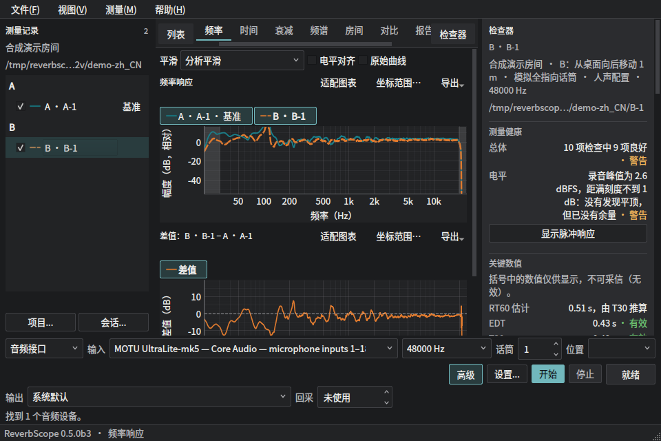
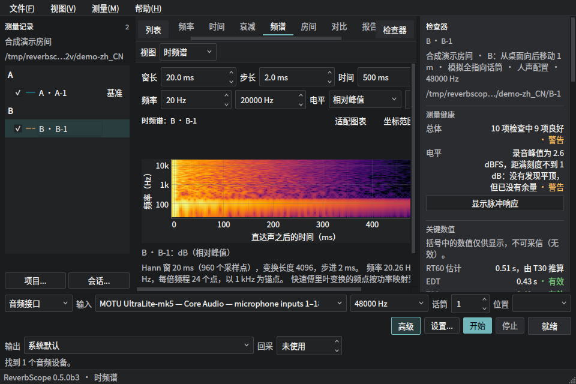
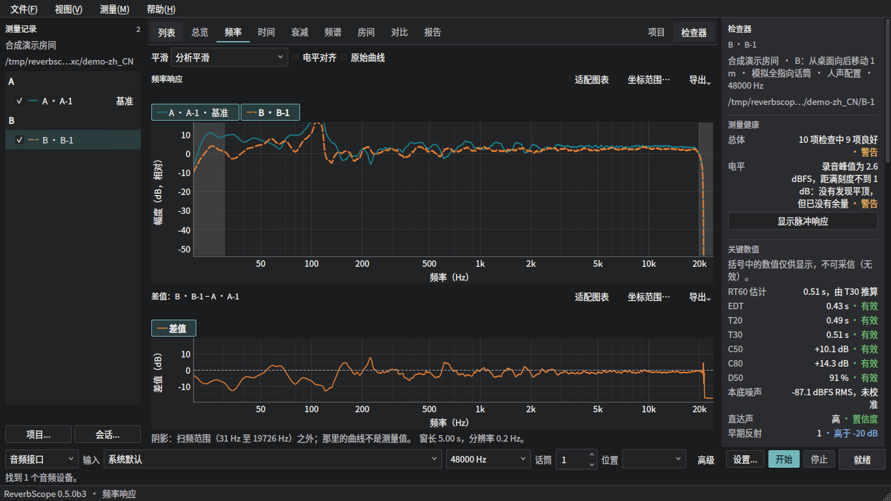
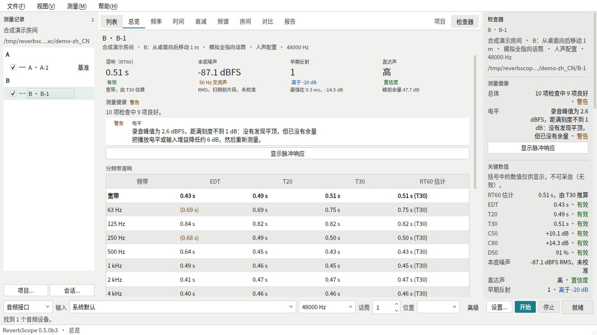
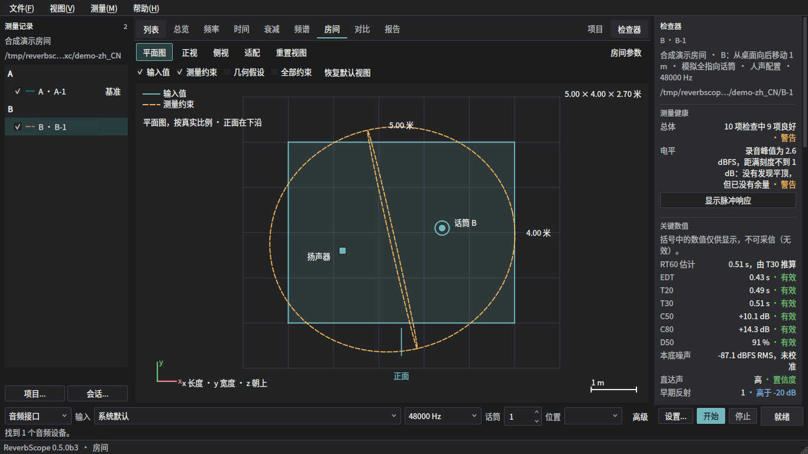

# Apple Silicon Mac：工作台最短实机验收

核对日期：2026-10-14（UTC+8）。对象：维护者的 Apple Silicon MacBook Pro，
macOS 14 或更新版本、一台实际使用的音频接口、Fender Studio Pro / Studio One。
本清单合并 PR #57 和 #58 的重复项目；所有实机结果仍为 **未运行**。
不假定当前连接的是哪款声卡、DAW 版本或显示器。

## 先确定验收的是同一个版本

- [PR #57](https://github.com/jingyemingyue/ReverbScope/pull/57) 是对 main 的工作台变更：
  `72a773791975bdd637a77dde1d393b170510588e`，226 个变更文件。
- [PR #58](https://github.com/jingyemingyue/ReverbScope/pull/58) 叠在 #57 上：
  `987d66268888b60d6e9e6b54f379b4ec7c50ceb8`，17 个变更文件。
  提交号末尾是 **ceb8**。两份 PR 均为 open / draft；讨论中无补充验收结果。
- #57 的 [CI](https://github.com/jingyemingyue/ReverbScope/actions/runs/38273997108)
  和 [打包运行](https://github.com/jingyemingyue/ReverbScope/actions/runs/38273997032)
  成功。Apple Silicon DMG 校验值由 PR 记录为
  `987554295fd386ca0835d3d1b0e4089f90cf4f99fa0cc294887eaac441de2cfe`。
  该包只覆盖 #57，不包含 #58 或本次窄窗口修复。
- #58 的 [CI #202](https://github.com/jingyemingyue/ReverbScope/actions/runs/38341611922)
  九个 job 全部成功；sdist/wheel 成功不等于最终 macOS DMG 已做交互验收。
  本次新改动的 CI、安装包和实机结果必须另记，不能沿用旧提交的通过状态。

开始前：取包含两份 PR 和本次 GUI 修复的 arm64 包，核对它自己的 SHA256SUMS。
“帮助 → 用于错误报告的环境报告”中保存版本、构建提交、macOS、接口和 DAW 版本。
PR 检查快照的提交号可能不同；只有确认其代码树与目标 head 一致才算同一版本。
如果还没有这个包，先完成最终版本的本机打包或定向构建，再做下面第 1 项。
Release 工作流的路径过滤不会因为仅修改 GUI 文件就自动重新生成 DMG。

## 六步实测，约 25–35 分钟

| 顺序 | 只在这台 Mac 上操作 | 通过条件 / 最少保留的证据 |
| --- | --- | --- |
| 1 · 安装与原生窗口（4 分钟） | 从 DMG 拖入应用程序并从 Finder 启动；按安装指南处理首次打开和麦克风权限。中文深色与英文浅色各看一次，拖动分栏、缩小再放大，收起/恢复检查器；用菜单或 Command 快捷键打开频谱和项目。 | 无崩溃、黑屏、乱码、遮挡或无法操作的按钮；窄窗口的采样率、开始/停止可读，当前标签可见。保留原生截图和实际窗口逻辑宽高、屏幕可用区域、缩放/DPR。图片文件名或请求 1920×1080 不证明窗口实际有这个大小。外接屏仅在实际使用时补一次拖屏检查。 |
| 2 · 双测量与频率图（4 分钟） | 打开含两次测量的项目（可用合成样例检验交互）；独立切换选中、勾选、基准。频率图填 80–300 Hz、−20 至 15 dB；切换平滑与电平对齐，拖动/滚轮缩放，再点“适配图表”。悬停曲线读坐标。 | 列表三种状态互不替代；频率与差值的横轴同步，手动范围保持，适配恢复默认；长名称不挤掉 Hz/dB 单位。保留一张双图截图。 |
| 3 · 总览、频谱与房间（5 分钟） | 总览展开解读和检查器条件；时频谱/瀑布图隐藏当前测量并快速切换。房间开关参数栏，查看平面/正视/侧视/透视，选反射、移动相机、切走再回来。 | 数值与有效性可读；隐藏的测量不被延迟计算重新画回；房间尺寸和设备标签不裁切，用户相机不被重置。保留房间截图；发生问题时录屏。 |
| 4 · 保存、导出与重开（3 分钟） | 用原生对话框保存一个含中文和空格的路径，导出图表并重新打开；退出后重开项目。对未保存测量尝试退出并选“取消”。 | 对话框能取消；导出可打开；项目数据、基准/勾选状态和布局按既有约定恢复；取消退出保留未保存测量。记录路径和结果，无须遍测文件格式。 |
| 5 · 真声卡与 Stop（6 分钟） | 监听音量先调低。输入/输出选实际接口，48 kHz 完整扫频一次；在另一遍扫频播放中点停止，再用 Esc 停一次，期间切换分析视图。按实际支持情况补一遍 44.1 或 96 kHz、一路大于 2 的通道；低音量下断开接口检查失败处理。 | 实际出声/收声的通道正确，完整测量可分析、无缓冲异常；两种停止都立即结束声音且不生成成功测量；断连明确报错、无卡死。保存环境报告、日志中的 `audio stream:` 行、一次完整会话和停止/断连记录。听感不能证明“一个 callback 内停止”，精确时限另用回采记录。未支持的采样率/通道写不适用。 |
| 6 · 常用 DAW（5–10 分钟） | 按 [DAW 指南](user-guide/daw-setup.md) 在 Fender Studio Pro / Studio One 用同一接口、48 kHz 生成扫频，关闭自动拉伸/效果处理，播放并录话筒，导出 WAV，导入 DAW 录音方式分析。 | 录制/导出/分析完整成功；直达声置信度高且没有意外采样率或拉伸警告；设置页和测量条信息一致。保留导出/拉伸设置截图与结果。实际房间条件引发的低置信度先排查，不把所有无效指标直接认定为 GUI bug。 |

无接口或扬声器时可完成 1–4；5–6 必须写未运行，不能用 fake 后端替代。
物理回采、另一台接口、另一款 DAW、全部采样率和负向拉伸测试留在完整
[硬件矩阵](HARDWARE_TESTS.zh-CN.md)，不把它们伪装为已完成。

## 已有证据够用的部分

| 证据 | 可接受的结论 | 不能据此推出 |
| --- | --- | --- |
| #58 九个 CI job | 原 head 的跨平台自动测试、类型/格式、schema、许可证、sdist/wheel 已通过；不必在 Mac 重跑几千条测试充当实机验收 | 真实 Core Audio、DAW、原生对话框或当前新 head 已通过 |
| #57 构建、摘要和 `check_macos_dmg.py` 记录 | 旧包的架构、依赖、构建标记、临时签名和离屏启动有证据 | 新 GUI 已打进旧包；经过公证；完整交互验收成功 |
| #57/#58 离屏截图和 GUI 状态测试 | 合成数据下的图表、状态和布局可复查 | Retina、触控板、Cocoa 窗口几何或实机播放行为 |
| 本次窄窗口回归和下方截图 | 设置与开始/停止分行、完整设备提示、快捷键选择标签可见、坐标轴可滚动到达已在 Linux 离屏检查 | 任何 Mac 或硬件通过结果 |

本次修改范围：`ui/measure_strip.py`、`ui/analysis_workspace.py`、`ui/plotkit.py`、
`ui/widgets.py`、`ui/views/frequency.py`、`ui/views/timefreq.py` 及 GUI 回归测试；
不改变声学计算、文件格式或音频驱动。原 `docs/images/gui2/` 主图库仍是较早版本；
下面的 acceptance 子目录来自本次代码，均为合成测量。

### 本次视觉证据

1. 窄窗口频率图：测量条分行，开始/停止保持可见；两个图表可竖向滚动，坐标轴不被图表父控件截断。设备名是测试夹具，无真实声卡。
   
2. 窄窗口频谱：选中的频谱标签自动进入可见区域；图表、超宽参数和完整说明可滚动查看。
   
3. 宽窗口频率图：保持单行测量条。
   
4. 总览：数值表在主要阅读区域，长内容可滚动。
   
5. 房间平面图：尺寸与设备标签在画布内；原生窗口仍需第 3 步验证。
   

## 什么阻止推进

- 当前两个 PR 明确以原生 Mac 验收缺口保留 draft；第 1–4 步未记录前，GUI
  验收仍不完整。#57 还明确留下硬件、DAW、播放/停止和打包应用缺口，5–6 未跑不能改成通过。
- 对最终 head 的 CI 失败、包与代码版本不一致、窗口截断关键操作、停止后持续出声、
  错通道、崩溃/卡死、保存丢失或隐藏测量重新出现，都应先修复再验收。
- 未运行与失败分开记录。轻微间距、配色偏好可作后续问题；漏测项目如决定后续跟踪，
  由维护者明确变更合并条件，不能静默删除验收缺口。
- 单台 Mac 的全部六步通过，仍不满足正式 0.5.0 的
  [发布门槛](RELEASE_PLAN.md#2b-the-050-gate)：Mac/Windows、至少两款接口和两款 DAW
  等要求继续按原计划执行。这不是要求为本 GUI PR 一次遍测十一款 DAW。
- 合并顺序：先完成 #58 的增量审查并整合到 #57，核对整合后 head 的 CI 和构建，
  然后审查 #57 到 main；每次有实质 GUI/播放修复，只重验受影响行。

## 结果留档（维护者填写）

日期 / Mac 与 macOS / 构建 SHA（或快照树）/ DMG SHA256 / 接口及驱动 /
DAW 版本 / 采样率及缓冲 / 原生窗口大小与 DPR：**待填写**。

| 项目 | Pass / Fail / 未运行 / 不适用 | 截图、日志或失败步骤 |
| --- | --- | --- |
| 1 安装与窗口 | 未运行 | |
| 2 测量与频率 | 未运行 | |
| 3 总览、频谱与房间 | 未运行 | |
| 4 保存与重开 | 未运行 | |
| 5 真声卡与停止 | 未运行 | |
| 6 常用 DAW | 未运行 | |
