# Focused desktop: draft review

The execution standard is [GUIDELINES.zh-CN.md](../GUIDELINES.zh-CN.md).
This is a maintainer-requested GUI redesign for review, not a release or a
hardware acceptance claim. The base is main `01291d8`, after PR #69.
Implementation and provenance are described in
[GUI_2_ARCHITECTURE.md](GUI_2_ARCHITECTURE.md) and
[GUI_REFERENCE_AUDIT.md](GUI_REFERENCE_AUDIT.md).

## Design

Photoshop's separation of document canvas, task options and optional
properties is the reference. ReverbScope now uses neutral charcoal chrome,
a large single canvas, four task destinations and a contextual view selector.
Measurements and Properties are closed by default and cover an edge without
resizing the chart. The interface and DAW workflows have distinct steps;
only an active take's transport stays visible across tasks.

The overview leads with four metrics and interpretation. Tables and
diagnostics expand on demand. Frequency response versus difference, and
decay curves versus band metrics, use full-canvas switches. Spectral
parameters expand when needed. Existing stored data, uncertainty, warnings,
validity and per-topic comparison verdicts remain available.

## Before and after

All images below use synthetic demo data and offscreen Qt. They do not show
hardware measurements. Before images use the main-branch GUI; after images
use this branch, with the same two-position demo. Chinese font fallbacks
were installed on the QA host; no font is bundled by this change.

| Main: permanent workstation columns | Draft: focused task canvas |
| --- | --- |
| 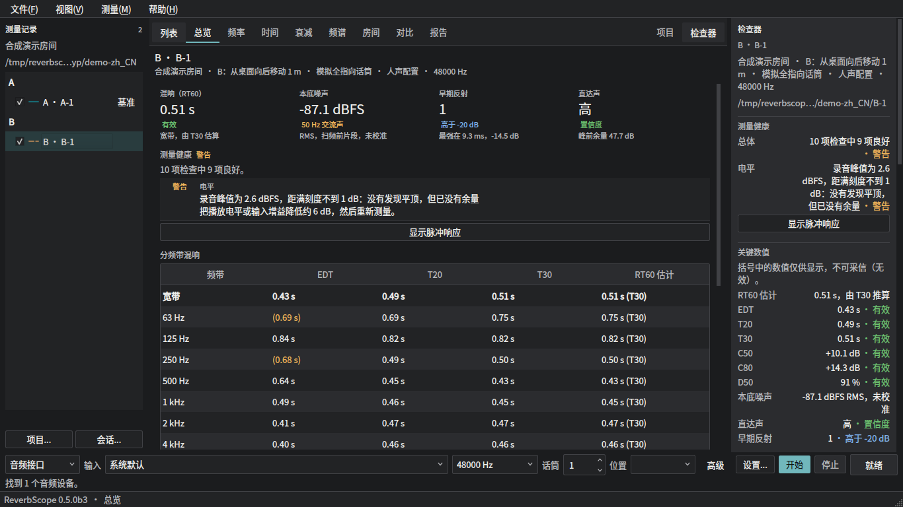 | 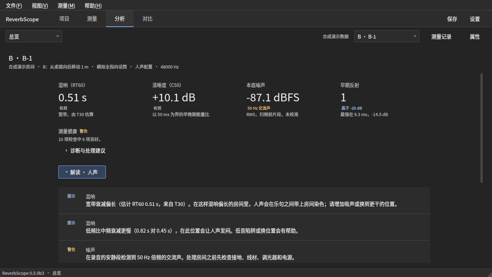 |
| 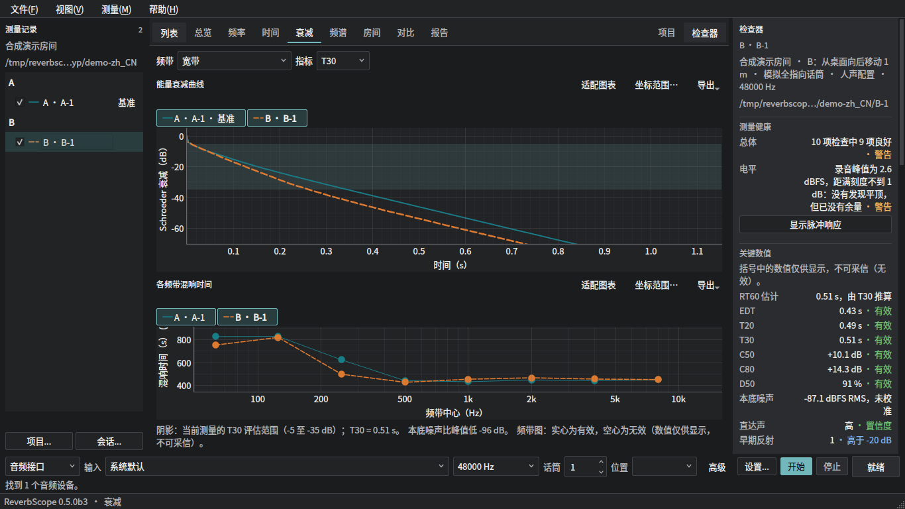 | 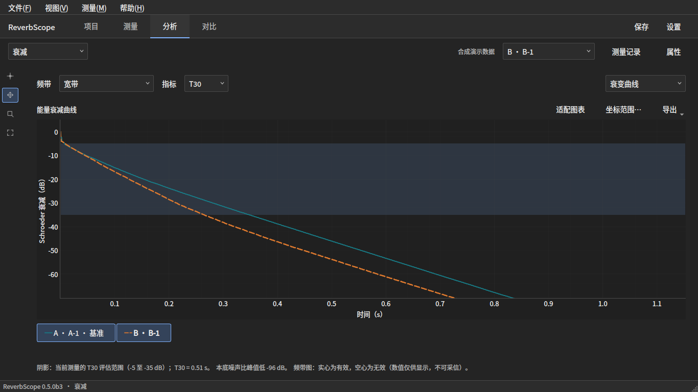 |

| Other task or state | Screenshot |
| --- | --- |
| Measurement review, Chinese, 1280×800 at 2× device pixels | 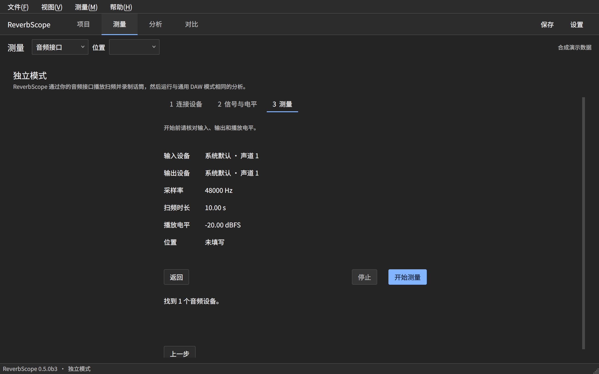 |
| Frequency response, English, light preference, 960×640 | 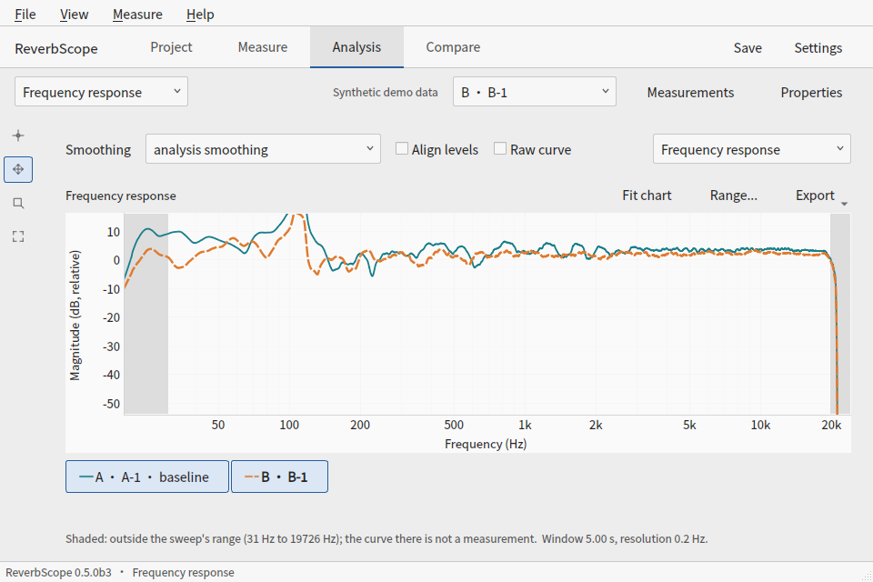 |
| Room, Chinese, entered example geometry and measured constraints | 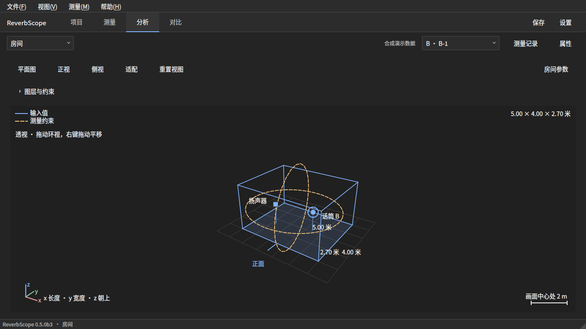 |
| Comparison, English | 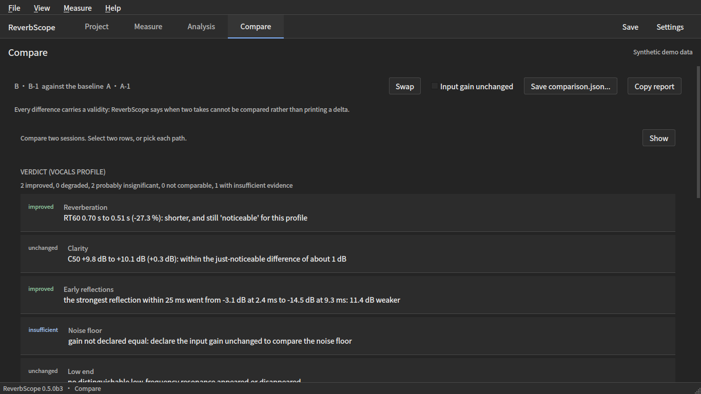 |
| Optional properties drawer | 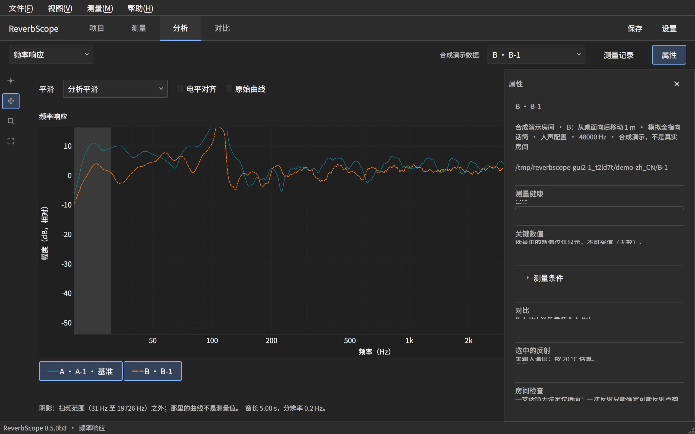 |

## Feature coverage

| Capability | Implementation retained or reconstructed |
| --- | --- |
| Sweep → playback/recording → deconvolution → IR | `ui/pages.py`, existing measurement and analysis workers / preflight |
| Overview, RT / EDT / T20 / T30 / C50 / C80 | `ui/views/overview.py`, complete expandable metric tables |
| Schroeder decay and per-band reverberation | `ui/views/decay.py`, full-canvas chart switch |
| Frequency response, smoothing, overlays, alignment, baseline difference | `ui/views/frequency.py` |
| Impulse / ETC, early reflection selection | `ui/views/impulse.py`, linked room selection and expandable table |
| Noise spectrum and hum | `ui/views/noise.py` |
| Spectrogram and waterfall, transform controls, slice selection | `ui/views/timefreq.py`, original cancellation/cache/generation behavior |
| Full report and copy | `ui/views/report.py`, shared report renderer |
| 3D room, layers, camera/picking, placement, scan import | `ui/room/`, projected QPainter scene hosted in pyqtgraph |
| Comparison and project workflow | `ui/compare_view.py`, `ui/project_view.py`, original verdict and spatial-average data |
| Health diagnosis and chart routing | `ui/health_nav.py`, overview, optional inspector |
| Settings and bilingual UI | `ui/settings_dialog.py`, existing gettext `.po` catalog |

## Automated evidence

Commands run from the worktree with Python 3.12, the existing `dev,gui`
dependencies, and `PYTHONPATH=src`.

| Command | Result |
| --- | --- |
| `ruff check . && ruff format --check .` | Passed; 362 files already formatted |
| `mypy --platform linux` | Passed; 128 source files |
| `python scripts/check_doc_links.py` | Passed; docs and nine root documents |
| `python scripts/check_cli_docs.py` | Passed; 80 commands parsed for syntax, none executed |
| `python scripts/check_src_safety.py` | Passed |
| `QT_QPA_PLATFORM=offscreen pytest --cov=reverbscope.core --cov=reverbscope.models --cov-fail-under=85` | Passed; 3463 passed, one font-availability skip; 93.43% coverage against the 85% gate; clean process exit |
| `QT_QPA_PLATFORM=offscreen pytest tests/ui/test_gui_smoke.py::test_charts_draw_chinese_text_with_an_installed_cjk_font tests/ui/test_gui_zh.py` | Passed; five font/localization tests |

The full run's existing font-availability check skipped because Matplotlib's
loaded font cache had no CJK face. After a QA-host fallback was installed and
the cache refreshed, that exact test and the four Chinese-interface tests
passed in a fresh process. No skip was added and no font is bundled.

The screenshot runner covers 21 states × four sizes (960×640, 1280×800,
1366×768, 1920×1080) × two themes × two languages = 336 images.
Two additional 1280×800 dark runs at 2× device pixels include optional
measurement/properties drawers, spectral settings and four room cameras:
30 more images, 366 captures total. All four runner invocations exited
successfully. The following commands reproduce their flags with an example
output folder:

```bash
QT_QPA_PLATFORM=offscreen python scripts/render_gui2_screenshots.py --out /tmp/gui-review --lang en
QT_QPA_PLATFORM=offscreen python scripts/render_gui2_screenshots.py --out /tmp/gui-review --lang zh_CN
QT_QPA_PLATFORM=offscreen python scripts/render_gui2_screenshots.py --out /tmp/gui-review --lang en --width 1280 --scheme dark --scale 2 --view overview --view fr --view spectrogram --view room --view measure_connection --view measure_review --view settings --panels --cameras
QT_QPA_PLATFORM=offscreen python scripts/render_gui2_screenshots.py --out /tmp/gui-review --lang zh_CN --width 1280 --scheme dark --scale 2 --view overview --view fr --view spectrogram --view room --view measure_connection --view measure_review --view settings --panels --cameras
```

Each state was constructed and captured; selected before/after, narrow,
Chinese and 2× images were visually inspected. This is not a pixel-diff gate
or an assertion that every capture received a human review.

Behavior tests were migrated from splitter/mirrored-control assumptions to
persistent task pages and canonical controls. Their data, validity, safety,
range, export, unsaved-take and worker-lifetime checks remain. New tests
cover task switching without losing chart/document state, canvas tool modes,
saved-demo marking, and review values matching the selected settings.
Measurement controls now enter their final Qt layout directly, and the room
canvas detaches its custom scene item before closing the graphics view.
A new regression creates and closes eight windows, visits every measurement
step, checks the native table header type and confirms the windows are freed.
That regression passed; a separate 24-window lifecycle stress run also
completed without a crash.
A read-only AST comparison also confirmed that 18 existing preflight,
recording/analysis, cancellation and placement-argument methods are unchanged;
`core/`, `models/`, the audio backend, workers and dependency manifest have
no diff. All existing test functions remain. No skips, expected failures or
lower coverage gates were added.

## Remaining acceptance

Setup pages scroll vertically at short window heights. The top step buttons
also provide Previous/Continue navigation; the active take's Stop transport
stays outside the scrolling page. Review setup navigation on native screens.

Native macOS/Windows appearance, real audio-device names and channel lists,
a real sweep, immediate hardware mute, a DAW round trip and long-session
comfort still need maintainer testing. Offscreen screenshots and the fake
backend do not satisfy those checks. Keep the PR draft and require a
maintainer review before any merge. Public-release README images remain
on their current release design until the draft is accepted.

## 曲线与加载边界复核

本轮以 GUIDELINES.zh-CN.md §4 C1/C2/C9/C10/C12、§15、§18 为依据，沿用
现有 Photoshop 风格。没有改变保存的测量数字、测量流程或文件格式。

- 平滑使用正项分层求和，避免强峰之后的低电平区因累计量相减而丢失。
  已知 -100 dB 平台在旧实现中会被错画成 -300 dB。
- 显示抽样保留首尾端点；缩放到相邻样本之间时仍保留穿过视口的线段。
- 默认纵轴保留窄峰和基线，只用当前可见、已扫频的频率区间决定范围；
  扫频外的 DC / 边缘值不再把有效曲线挤出画面。差值图按共同测量区间取景。
- 差值图等待当前测量完成加载；数据尚未到达时显示占位，随后可正常恢复。
- 图例去掉常亮蓝底，保留颜色线样、当前项粗体、显隐开关、悬停和键盘焦点。

**准则差异供审查。** §15.3 的固定默认纵轴范围可裁掉窄峰。本轮保留已有
手动范围行为，让默认范围在必要时扩大到实际测量数据的极值；未修改准则。
这个取景策略作为草稿交给维护者审阅。

新增回归均保留先失败后通过的证据；曲线与 GUI 定向检查 **40 passed**。
131072 点的 1/12 倍频程显示平滑，预热后 5 次中位耗时 **34.584 ms**；
这是本容器的合成数据测量，不是原生平台性能承诺。结果沿用工作区显示缓存。
完整检查的命令、结果及 CI 链接记录在 PR #71 的交接说明。

离屏验证生成 **210 张**截图：21 个状态覆盖四种窗口尺寸的 1×/2× 中文深色，
另补英文深色和中文浅色。PNG 全部可解码；已抽查部分宽/窄窗口、中文、设置
与测量确认，未声称逐张人工验收。[尺寸、源码指纹及图像校验记录](../evidence/GUI_FOLLOWUP_RENDERS.json)。
QA 主机使用系统 Noto Sans CJK SC 回退，仓库与分发包没有加入字体文件。
这些图片均为合成演示；未进行真实声卡、DAW、原生 macOS/Windows、Retina 或旁白验收。

| 调整前（dc82b76） | 本轮曲线取景与图例 |
| --- | --- |
| 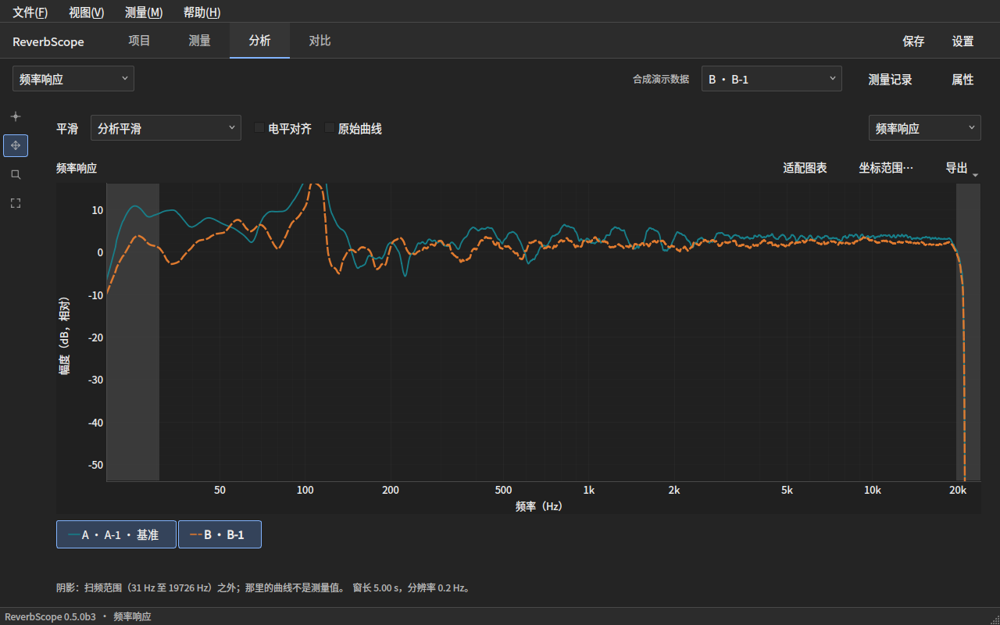 | 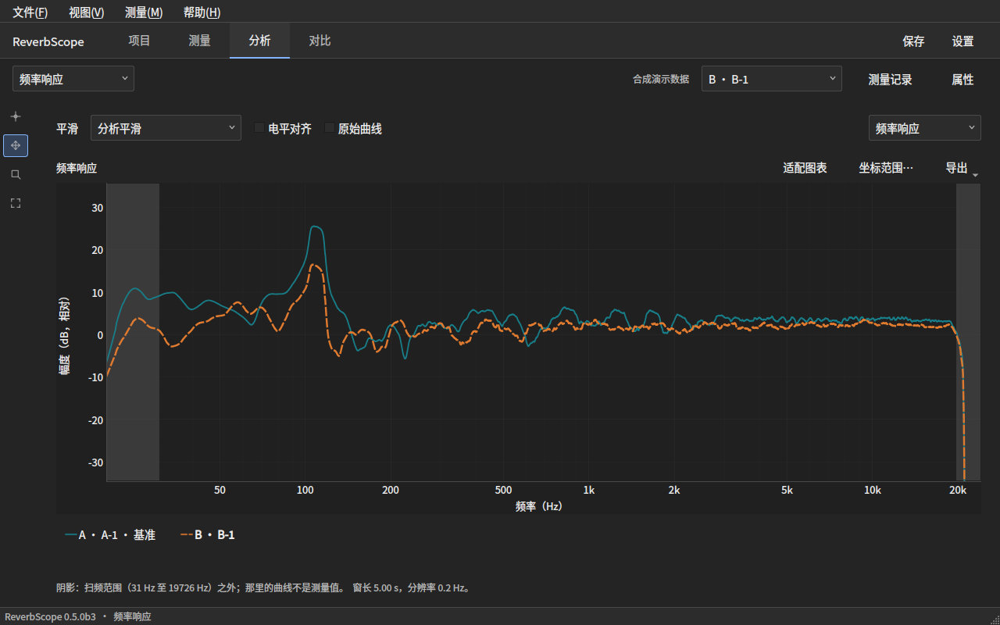 |

[窄窗口频响](../images/gui-focused/followup-frequency-narrow.zh-CN.png) ·
[窄窗口总览](../images/gui-focused/followup-overview-narrow.zh-CN.png) ·
[测量确认](../images/gui-focused/followup-measurement.zh-CN.png) ·
[浅色设置](../images/gui-focused/followup-settings-light.zh-CN.png)
