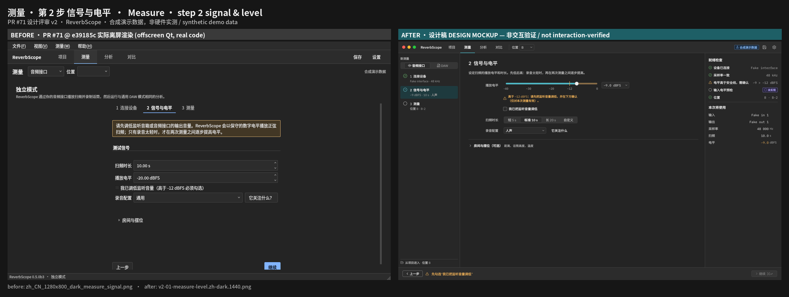
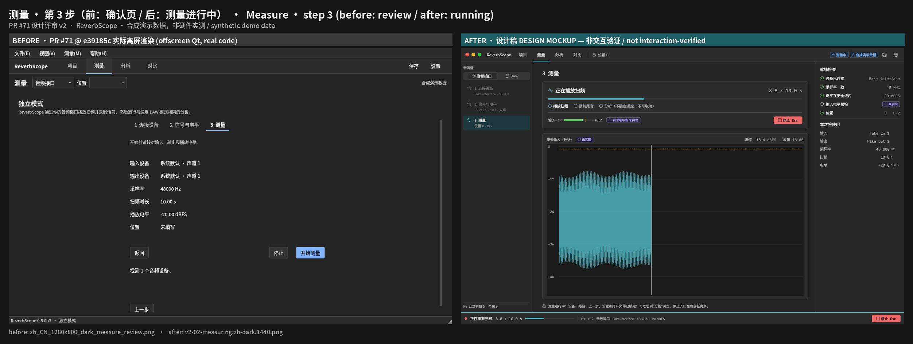
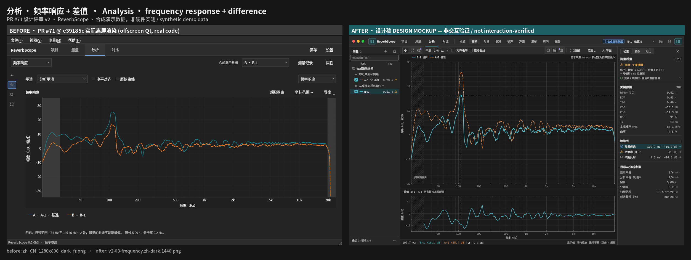
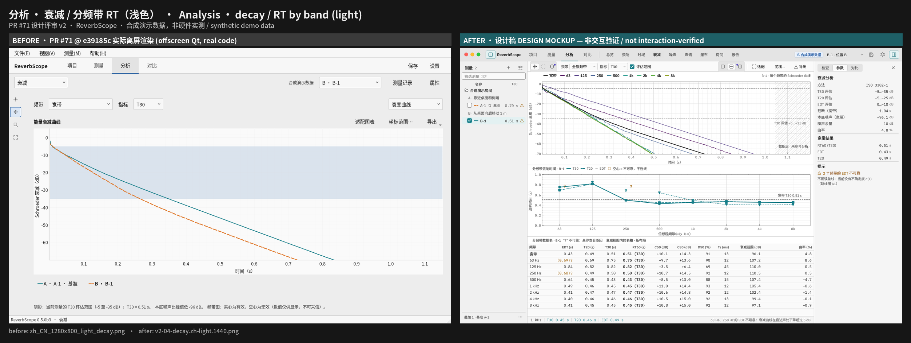
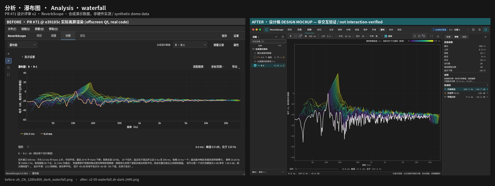
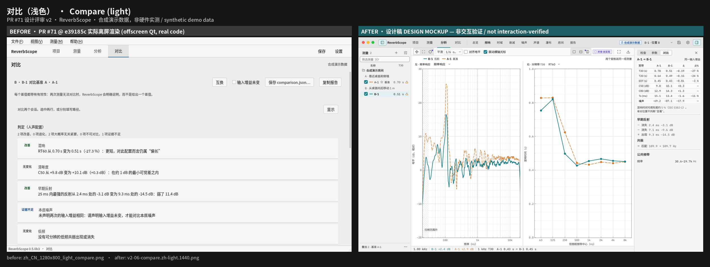
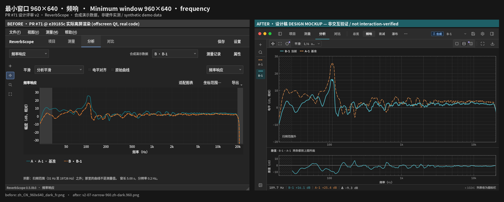
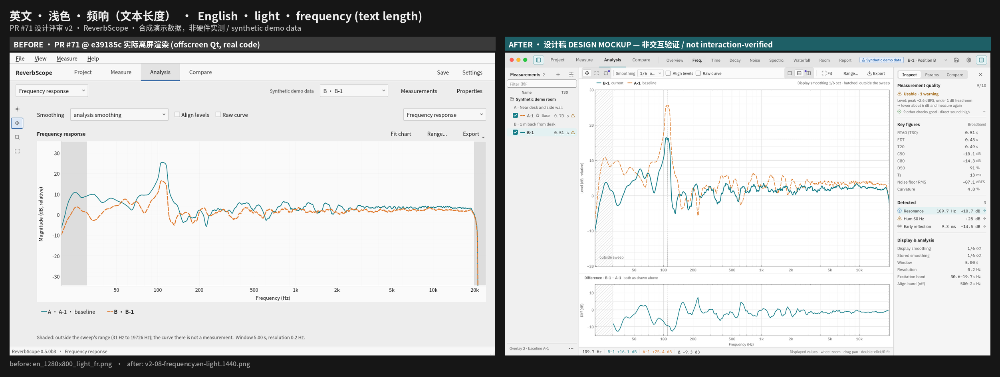

# PR #71 设计评审 v2（GUI 视觉 / 专业音频交互）

> 对象：PR #71 `gui/photoshop-focused` @ `e39185ceacbe6c8dc9a15dfffdb9e40be7062796`（草稿，base `main`）。
> 本文是设计评审，不是代码审查，也不是验收。执行标准仍是 [GUIDELINES.zh-CN.md](../../GUIDELINES.zh-CN.md)
> （v2.1.1）；本文引用其章节作为验收依据，不修改准则。
> 视觉规格见 [SPEC.md](SPEC.md)，给 GUI 开发者的实施顺序见 [HANDOFF.md](HANDOFF.md)，对比度数据见 [CONTRAST.md](CONTRAST.md)。

## 0. 证据级别（先读）

| 类别 | 来源 | 能证明什么 | 不能证明什么 |
| --- | --- | --- | --- |
| **BEFORE 截图** | 在 `e39185c` 检出后，用仓库自带 `scripts/render_gui2_screenshots.py` 离屏渲染（PySide6 6.x，`QT_QPA_PLATFORM=offscreen`，假后端合成演示数据，Linux，系统 Noto Sans CJK 回退字体）。存于 `images/before/` | 该提交的真实布局、文案、配色和默认状态 | 原生 macOS / Windows 外观、Retina 实机、真实声卡、交互时序 |
| **AFTER 图** | `prototype/` 中的设计稿渲染器（在 PR #79 原型套件上改造），存于 `images/after/` | 目标视觉、密度、层级 | **任何功能已实现**。所有 AFTER 图都是**设计稿（design mockup），不是交互验证** |
| **代码证据** | `e39185c` 上的 `file:line` | 行为是否存在 | 运行时手感 |

静态截图不能替代交互验收；需要真机 / 真人交互验证的项目列在 §6。

AFTER 图的演示曲线来自 `reverbscope demo` 输出经 PR #79 原型的取数逻辑，和 BEFORE 的 App 内渲染不是逐像素同一数据
（平滑与取景不同），只用于比较布局与图表样式，不用于比较数值。

## 1. 结论（一段话）

PR #71 的方向是对的：四个任务入口、分步测量、单画布、全局 Stop/Esc、gettext、真实复用原有 worker 与预检，这些都应保留。
它离“专业测量工具”还差三件事：**(1) 安全与流程的“状态先于说明”没有落地**——电平确认要点了“开始测量”才弹框，
步骤可以随意跳、操作栏随内容滚出视口；**(2) 画布被六层横条挤压**——960×640 下绘图区只剩约 220 px 高（窗口 34 %）；
**(3) 图表还停在“能看”而不是“能读数”**——深色主题沿用浅色数据色、基准不是虚线、网格几乎不可见、读数只给一条曲线、
衰减图没有拟合线、瀑布图透视位移改写了横轴含义。v2 设计稿保留 PR #71 的任务结构与分步流程，把 PR #79 的图表视觉和密度
装进来：44 px 单行应用栏代替“任务栏 + 上下文栏 + 状态栏”，左侧测量列表 / 右侧检查器按断点停靠或覆盖，测量向导改为
左侧步骤条 + 常驻底部操作栏。

## 2. 既有问题编号的状态（SAFE-01 / BUSY-01 / FLOW-01 / ESC-01）

**定义来源未找到。** 已检索：`e39185c` 全部 `docs/`、PR #71 正文与评审（0 条评审、0 条评论）、PR #79 分支 `docs/design/pro/`、
仓库 issues / PR 全文搜索（`SAFE-01` 等 4 个关键词均 0 命中）。工作记录显示这些编号出自一份外部（Manus）40 条评审，
原文未提供。以下含义为**根据上下文推断（inferred）**，状态按 `e39185c` 代码判定：

| 编号 | 推断含义 | e39185c 状态 | 依据（摘要，详见 §4） |
| --- | --- | --- | --- |
| SAFE-01 | 扫频前输出电平 / 扬声器安全 | **未解决（部分）**：有 −12 dBFS 门槛和确认框，但门槛在点击“开始测量”后才以弹框检查；确认框在第 2 步、主按钮在第 3 步；确认不随每次测量重置；确认页不显示确认状态 | `ui/pages.py:926-937`、`:1405-1415`；全文件无 `acknowledge.setChecked(False)` |
| BUSY-01 | 测量 / 分析进行中的忙碌与禁用状态 | **未解决（部分）**：步骤、上一步、模式与位置已锁；但“设置”（模态 `exec()`）、打开会话 / 项目、`⇧⌘1` 切到 DAW 页在测量中仍可用，模态会盖住 Stop | `ui/main_window.py:882-887`、`:571-626`、`:682-700`；`ui/pages.py:314-323` |
| FLOW-01 | 测量流程的连续性 | **未解决**：步骤按钮可任意跳转、无完成状态；“继续”不校验；操作行随页面滚动（1280×800 下首屏看不到）；确认页同时有“返回”和“上一步” | `ui/pages.py:265-323`、`:964`、`:1020-1028`；`ui/widgets.py:193-210`；截图 `before/zh_CN_1280x800_dark_measure_signal.png` |
| ESC-01 | Esc / Stop 的优先级 | **未解决（部分）**：发声时 Esc 能停止（`MeasureStrip` 可见时）；但非测量时 Esc 不关闭抽屉（准则 §11.5），分析阶段 Esc 静默无反馈，模态打开时第一下 Esc 被模态吃掉 | `ui/measure_strip.py:80-82`、`:131-139`、`:155-157`；`ui/components/details_drawer.py`（无按键处理） |

建议维护者把外部评审原文放进仓库（或贴进 PR 评论），以便下一轮按原始定义复核；本文的新编号与上述 4 个并列，不覆盖。

## 3. 布局、信息层级与四个任务的流转

### 3.1 现状（BEFORE）的垂直预算

1280×800 深色频响页，自上而下：Linux 菜单栏 28 → 任务栏 46 → 上下文栏 52 → 视图选项行 ~50 → 图表标题行 ~30 →
**绘图区** → 图例 48 → 注脚 ~40 → 状态栏 22。960×640 时绘图区约 **220 px（34 %）**（`before/zh_CN_960x640_dark_fr.png`）。
`MIN_PLOT_HEIGHT = 260`（`ui/design/tokens.py:16`）包含坐标轴，刚好压线。

v2（`after/v2-07-narrow-960.zh-dark.960.png`）：应用栏 44 → 图表工具条 34 → 图例 24 → 绘图区 → 差值窗 → 读数栏 24。
同尺寸下主绘图区约 **338 px（53 %）**，另有联动差值窗。

### 3.2 四个任务

| 任务 | PR #71 | 问题 | v2 |
| --- | --- | --- | --- |
| 项目 | 启动面板 / 项目页 | 卡片多、留白大（P2 AI-01） | 保持，按准则 §12.1 收紧 |
| 测量 | 顶部步骤标签 + 居中 900 px 表单 + 页内操作行 | FLOW-01、SAFE-01、FORM-01 | 左侧步骤条（状态图标）+ 640 px 表单 + 右侧“就绪检查” + 常驻底部操作栏；发声时底部任务条 |
| 分析 | 视图下拉 + 第二个“呈现”下拉 + 左侧 48 px 工具栏 + 覆盖抽屉 | LAYOUT-01/02/03、CHART-* | 应用栏内分段视图标签；工具并入图表工具条；列表 / 检查器按断点停靠 |
| 对比 | 文字判定列表 | COMPARE-01 | 左右双图（联动光标）+ 右侧判定表 |

流转：测量完成自动跳到新测量的“总览”（`ui/main_window.py:752-753`）——这一点 PR #71 已做对，保留。

## 4. 问题清单（P0 / P1 / P2）

优先级：**P0** = 安全或流程阻断，合并前必须解决；**P1** = 专业可读性 / 准则明确违背，合并前应解决或由维护者明确豁免；
**P2** = 打磨、平台核对或需要维护者决策。所有“证据”均可在 `e39185c` 复核。

### P0

| ID | 领域 | 问题 | 证据 | 修复 | 验收 |
| --- | --- | --- | --- | --- | --- |
| SAFE-01 | 测量安全 | 电平超过 `SAFE_MAX_LEVEL_DBFS`（−12）时，确认框只在点“开始测量”后用 `QMessageBox.warning` 检查（“能点，点了才弹框说不行”）；确认框在第 2 步，主按钮在第 3 步；确认后永不复位；确认页不列出确认状态；安全提示是整条橙色横幅 | `ui/pages.py:926-937`（电平 + 确认框）、`:1405-1415`（弹框）、`:872-874`（横幅）、`:1006-1017`（确认页字段无确认项）；`audio/backend.py:30-31`；截图 `before/…measure_signal.png`、`before/…measure_review.png`；准则 §12.3 第 2 步、§17.2、C8 | 电平用带安全区刻度的滑块 + 数值框（`after/v2-01`）；超出安全区时在控件下方一行警示 + 必勾确认；**“继续 / 开始测量”在条件不满足时禁用，并在按钮旁和悬停提示里写原因**；每次测量结束（成功 / 失败 / 停止）与电平改动跨过门槛时清除确认；确认页增加“监听音量已确认”行 | ① 电平 −9 dBFS、未勾选：主按钮禁用，操作栏显示“先勾选‘我已把监听音量调低’”，无弹框；② 勾选后可开始；③ 一次测量结束后回到第 2 步，确认框为未勾选；④ 电平 −20 dBFS 时确认框显示为“不需要”且不阻断；⑤ UI 测试覆盖 ①–④ |
| FLOW-01 | 测量流程 | 步骤标签可任意点击，无完成 / 当前 / 未完成状态；“继续”不做任何校验；操作行（上一步 / 继续 / 开始 / 停止）放在滚动页内，1280×800 时在首屏之外；确认页同时出现“返回”（离开向导）与“上一步” | `ui/pages.py:265-323`（`MeasurementSteps`：`:280-287` 自由跳转、`:296-297` 无校验）、`:964`、`:1020-1028`；`ui/widgets.py:193-210`（`scroll_page`）；截图 `before/…measure_signal.png`（底部“继续”被裁）、`before/…measure_review.png`（“返回”与“上一步”并存）；准则 §12.2“常驻操作栏”“步骤状态” | 左侧步骤条：完成 ✓ / 当前 ● / 未完成 ○ / 锁定 🔒，未满足前置的步骤不可跳入；底部 48 px 常驻操作栏（上一步 · 一行状态 · [停止] · 主操作 ⌘↩），**不随内容滚动**；“返回”移出向导（Esc 或应用栏任务切换即可离开） | ① 960×640 与 1280×800 下操作栏始终可见；② 第 1 步设备未就绪时第 2、3 步不可点，悬停说明原因；③ 每步主按钮禁用时有一行原因；④ 改文字后 ⌘↩ 仍有效（准则 §12.2 实现提示）且有测试 |
| BUSY-01 | 忙碌状态 | 测量进行中仍可打开“设置”（模态）、“打开会话 / 项目”文件对话框，可用 `⇧⌘1` 把画面切到 DAW 页；模态盖住底部 Stop，第一下 Esc 只会关闭模态 | `ui/main_window.py:882-887`（`SettingsDialog(self).exec()` 无忙碌判断）、`:571-626`、`:682-700`（忙碌保护只覆盖 demo/standalone）；`ui/analysis_workspace.py:167-174`（保存 / 设置按钮常亮）；准则 §11.4“锁定设备相关操作”、§12.2“锁定路径切换、上一步和打开其他向导的快捷键”、P9 | 统一 `busy` 状态源：发声期间禁用 设置、打开…、打开项目…、新测量、路径切换快捷键；禁用的入口有悬停原因“测量进行中”；分析阶段同样锁定路径与上一步，但允许浏览分析视图 | ① 发声时上述入口全部禁用且有原因；② 发声时不存在任何可打开的模态；③ 分析阶段任务条显示“正在分析”（不确定进度，不可取消）；④ UI 测试逐项断言 |
| ESC-01 | 键盘 / 安全 | Esc 只绑在 `MeasureStrip` 上（`WindowShortcut`，控件隐藏时快捷键不生效）；非测量时 Esc 不关闭抽屉 / 浮层；分析阶段按 Esc 无反馈；下拉弹层或模态打开时 Esc 先被它们消费 | `ui/measure_strip.py:80-82`、`:131-139`（`setVisible(busy)`）、`:155-157`；`ui/components/details_drawer.py`（无 Esc 处理）；准则 §11.5“测量中：停止（优先级最高）；其他时候：关闭抽屉、向导或弹层” | `QApplication` 级事件过滤器统一处理 Esc，顺序见 SPEC §9.2：发声 → 停止并静音（先于任何弹层）；图表手势 → 取消；覆盖式抽屉 / 检查器 → 关闭；向导 → 回到来时视图（输入保留）；其他 → 无操作 | ① 发声时焦点在任意控件（含打开的下拉）按一次 Esc 即停止；② 非测量时打开的覆盖抽屉按 Esc 关闭；③ 分析阶段按 Esc，任务条短暂提示“分析不可取消”；④ 真机测停止到静音的延迟（§6） |

### P1

| ID | 领域 | 问题 | 证据 | 修复 | 验收 |
| --- | --- | --- | --- | --- | --- |
| CHART-01 | 曲线配色 | 深色与浅色主题共用一套数据色（浅色值）。深色画布上 `#177e89` 3.40:1、`#7a5cc7` 3.25:1，发灰；浅色画布上橙 `#e07a2e` **2.88:1 未达 3:1**。衰减图另用 `PLOT_SERIES` | `ui/workspace.py:60-69`、`ui/theme.py:30`、`ui/views/decay.py:261`；[CONTRAST.md](CONTRAST.md) §1；准则 §13.2 深色列、§15.4 | 数据色改为 token，按主题取 §13.2 浅 / 深两列（SPEC §3.3）；衰减频带用 viridis 子集 token | 两主题全部数据色 ≥ 3:1（脚本校验），深色下 8 条曲线均为 §13.2 深色值 |
| CHART-02 | 曲线角色 | 线型按颜色序号取（`DASHES[color_index]`），截图中**基准是实线、当前是虚线**；线宽 2.4 / 1.8 / 1.15 与准则不符 | `ui/views/frequency.py:207`、`ui/workspace.py:177-181`；`before/…dark_fr.png` 图例；准则 §13.2“基准一律用虚线”、§15.2 | 线型按角色：当前 2.0 实线；其他叠加 1.25、80 % 不透明；基准 1.5 虚线 [5,3]；颜色仍跟测量走 | 任一测量设为基准后在所有图中变为虚线；当前测量始终最粗 |
| CHART-03 | 网格 / 坐标轴 | 网格单层、`alpha=0.15`，深色下几乎看不见；无主次网格；0 dB 线不加粗 | `ui/plotkit.py:340`、`:461`；`before/…dark_fr.png`；准则 §15.2 | 主网格（十倍频点 + 10 dB）与次网格（1-2-5 中间频点 + 2 dB）分 token；0 dB 线 `plot_zero` 1 px 实线；坐标轴线 `plot_axis` ≥ 3:1 | 截图中可区分主 / 次网格与 0 dB 线；token 校验通过 |
| CHART-04 | 读数 / 光标 | 读数只显示“当前曲线”一个值，以右下角提示文字呈现；无 A/B 光标、无差值 | `ui/plotkit.py:284-289`、`:792-804`；准则 §15.2“读数栏同时列出这个横坐标上每条可见曲线的值” | 图下 24 px 等宽读数栏：x、每条可见曲线值（曲线色）、相对基准 Δ，并注“显示值”；每条曲线在光标处打点（当前实心、其他空心）。A/B 放置光标为**未实现 / 需代码** | 悬停时读数栏列出全部可见曲线；隐藏曲线不出现；单元测试覆盖插值 |
| CHART-05 | 冗余标签 | 同一屏有三处“频率响应”：视图下拉、图表标题、右侧“呈现”下拉；“适配图表”文字按钮与左侧工具栏“适配”重复 | `ui/components/context_bar.py:23-27`、`ui/views/frequency.py:98-118`；`before/…dark_fr.png`；准则 §15.2“图表内不放标题”、§11.1“不再有右侧的第二组标签” | 删除图内标题；“频响 / 差值”用图表工具条上的布局切换（单图 / 上下 / 并排）；适配只保留一处（工具条 + 双击 + F） | 一屏同一名称最多出现一次 |
| CHART-06 | 衰减图 | 只画 Schroeder 曲线和评估区横带，**没有 T20/T30 拟合线**、没有截断点标注 | `ui/views/decay.py`（仅 `add_region`，无拟合线）；`before/…decay.png`；准则 §15.3 衰减行 | 在评估区内画拟合线（虚线，端点标记）、截断点后斜线阴影“未参与分析”、本底噪声线；分频带 RT 只连接相邻有效值，不可靠值空心并标“?” | 截图可见拟合段与截断阴影；不可靠频带不连线 |
| CHART-07 | 瀑布图 | 透视位移同时平移横轴（log Hz），后排切片的频率不能从横轴读；选中切片用状态色 `warn`；切片滑块与图表分离 | `ui/views/timefreq.py:538-560`；`before/…waterfall.png`；准则 §13.2“状态色永远不用作数据曲线的颜色” | 默认关闭透视（真实横轴）；开启时注脚写明“仅前排切片对应横轴”；选中切片用 `cursor` token；颜色按时间 viridis 并带色标；切片选择放进读数栏或图表工具条 | 默认状态下所有切片共享真实频率轴；选中切片不是状态色 |
| LAYOUT-01 | 画布高度 | 六层横条叠加，960×640 下绘图区约 220 px（34 %） | §3.1；`before/zh_CN_960x640_dark_fr.png`；`ui/main_window.py:201`（仍有状态栏，准则 §11.1 要求删除） | 44 px 应用栏合并任务 + 文档 + 全局操作；删除状态栏（信息进任务条 / 读数栏）；图例 24 px 行内；注脚进图表工具条的 ⓘ 悬停 | 960×640 下主绘图区 ≥ 窗口高度 50 %（设计稿 53 %） |
| LAYOUT-02 | 视图切换 | 9 个分析视图藏在下拉框里；`VIEW_GROUPS` 定义了分组却未用于界面 | `ui/analysis_workspace.py:39-49`、`:176`；准则 §11.1“一级视图用分段标签” | 应用栏内分段标签（SPEC §8）；空间不足时溢出到“⋯”；英文用短标签 | 1280 及以上全部可见；960 时至少 4 个 + 溢出菜单；不出现截断文字 |
| LAYOUT-03 | 抽屉 | “测量记录 / 属性”宽 352 px，始终覆盖画布，盖住曲线和读数；无 Esc 关闭 | `ui/design/tokens.py:13`、`ui/components/details_drawer.py:50-54`；准则 §13.5 断点 | ≥ 1440：列表 220 + 检查器 288 停靠推开画布；1024–1439：列表停靠、检查器覆盖；< 1024：列表收成 48 px 图标栏。覆盖层不遮挡读数栏 | 断点切换无闪烁；覆盖层 Esc 关闭；记住开合（`ui.ini`） |
| COMPARE-01 | 对比 | 对比页只有文字判定卡片，无曲线；差值图藏在频响视图的第二个下拉里 | `ui/compare_view.py`；`before/…light_compare.png` | 左：频响叠加（或差值）；右：分频带 RT；联动横轴光标；检查器“对比”页放判定表（保留现有判定与“不可比较”语义） | 打开对比即看到两图与判定表；判定文字与数据不变 |
| FORM-01 | 表单密度 | 采样率、时长、电平等短输入被拉满整行（~360 px）；页面最大宽 900 px 居中，两侧大片空白 | `ui/design/tokens.py:15`、`ui/pages.py:875-937`；`before/…measure_connection.png`；准则 §13.5“禁止把短输入拉满整行” | 控件宽按内容（采样率 160、数字 120、短文本 280）；表单最大宽 640，左对齐于步骤条右侧；右侧放就绪检查 | 截图中无短输入超过其宽度 token |

### P2

| ID | 领域 | 问题 | 证据 | 修复 | 验收 |
| --- | --- | --- | --- | --- | --- |
| AI-01 | 去模板感 | 区块用 GroupBox 顶线 + 22 px 外边距 + 24 px 区块间距 + 28 px 页边距；总览的解读行做成卡片；KPI 30 px；页面标题与内容左缘不齐 | `ui/design/styles.py:36-38`、`:14`；`ui/design/tokens.py:8-9`；`before/…overview.png` | 分组用标题 + 1 px 分隔线；区块间距 16；KPI 28；解读用行而不是卡片；统一左缘 | 无卡片套卡片；同一页左缘只有一条 |
| TOOL-01 | 指针工具 | 工具栏占 48 px 一整列只有 4 个按钮；无字母快捷键 | `ui/components/tool_rail.py`；`ui/plotkit.py:830-834`（仅 R） | 工具并入图表工具条（分段图标）；快捷键 V / H / Z / F（SPEC §9.1） | 960 宽度下画布多 48 px；快捷键在菜单中显示 |
| HIDPI-01 | @2x | 工具图标用 24×24 `QPixmap` 自绘，未设 devicePixelRatio，2× 下发虚 | `ui/components/tool_rail.py:14-16`；准则 §13.7、§18.1 | 按当前 DPR 渲染（SVG 或 `setDevicePixelRatio`） | Retina 实机图标边缘清晰（§6 人工） |
| MAC-01 | 平台 | 中文菜单带“(F)”助记符 | `locale/zh_CN/LC_MESSAGES/reverbscope.po:44-45`；`before/…dark_fr.png`；准则 §18.1 | 仅非 macOS 加 `(&F)` | macOS 真机菜单无“(F)” |
| I18N-01 | 中英文长度 | 英文文案比中文宽约 1.4–2 倍；若改为分段标签（LAYOUT-02），全名在 1440 宽下会被截断（设计稿首轮已复现） | `after/v2-08-frequency.en-light.1440.png`（改用短标签后通过） | 英文短标签表（SPEC §8.3）；全名放菜单与悬停提示；布局测试检查 `sizeHint` ≤ 宽度 | 960 / 1280 / 1440 下 zh、en 无截断 |
| THEME-01 | 浅色主题 | 浅色画布 `#fafafa` 与面板 `#f7f7f7` 几乎相同，图表区没有“仪器屏”分离；输入框边框 1.56:1 | `ui/design/tokens.py:41-62`；[CONTRAST.md](CONTRAST.md) | `plot_bg` 白、面板 `#f5f5f5`；输入边框用 `border_strong`（≥ 3:1） | 脚本校验通过 |
| ROOM-01 | 3D | 房间视图是 QPainter 投影的 3D 场景（轨道相机）；**不存在 3D 声学可视化**（无声场 / 模态 / SPL 体渲染）。准则 §10.4 把“3D 房间模型（D5）”列为反目标，§12.2 摆位要求 2D 侧视；PR #71 说明维护者要求保留房间功能 | `ui/room/canvas.py:1`、`:305-312`；`before/…room.png` | 默认打开平面 / 侧视 2D，3D 透视作为次要相机；不新增 3D 声学可视化；由维护者裁决 D5 与“保留房间”的关系 | 维护者书面决定 |
| FMT-01 | 数值格式 | 确认页直接显示控件文本：“-20.00 dBFS”用 ASCII 连字符、“48000 Hz”无分组；“位置：未填写”不提示 | `ui/pages.py:1062-1082`（`_update_review` 用 `self.level.text()`）；`before/…measure_review.png`；准则 §13.4、§16.5 | 用与 CLI 相同的数值格式（U+2212、单位前空格；准则 §16.5 计划中的 `presentation/format.py` 在 e39185c 尚不存在 → 【需代码】）；未填位置在就绪检查中显示“提醒” | 确认页与就绪检查数值格式与 CLI 一致 |
| DAW-01 | DAW 导入 | 导入步骤缺每声道峰值条（准则 §12.2 要求，且须由 core / io 纯函数计算） | `ui/pages.py:545-565` | **需代码（core/io 新函数，单独 PR）**；GUI 只显示 | 另开 PR |

## 5. 与 DAW / 测量软件交互逻辑的对照

只借鉴交互惯例，不复制资产（准则 §10.5、`GUI_REFERENCE_AUDIT.md`）。

| 参考 | 惯例 | PR #71 现状 | 建议 |
| --- | --- | --- | --- |
| Photoshop | 工具单字母快捷键；选项栏随工具变化；面板可停靠 / 浮动；Esc 取消当前操作 | 工具无快捷键；选项行与图表标题分开；抽屉只能覆盖 | V/H/Z/F；图表工具条即“选项栏”；断点停靠（LAYOUT-03） |
| REW | 测量列表 + 叠加；每张图有自己的工具条；滚轮缩放、拖动平移；光标处显示所有曲线值；Y 轴预设范围 | 列表在覆盖抽屉里；读数只一条曲线 | 停靠列表；读数栏多曲线（CHART-04）；纵轴范围预设菜单（±10 / ±20 / 50 dB 跨度）**需代码** |
| iZotope RX | 深色仪器屏；底部状态 / 读数条；频谱色标常显；Esc 停止播放 | 色标有；读数是提示文字 | `plot_bg` 深于外框；读数栏等宽；Esc 统一调度（ESC-01） |
| Cubase | 底部 Transport 常驻；录音时红色状态显性；Stop 快捷键稳定 | 任务条只在忙碌时出现（符合准则 §11.1） | 保留“只在忙碌时出现”，但做成 40 px、顶边 2 px 强调色、左侧红点 + 阶段 + 时间 + 进度 + 右侧大号“停止 Esc”（`after/v2-02`） |
| FabFilter | 图上直接读数与拖动；缩放区域清晰；数值框可滚轮微调 | 无 | 光标旗标；电平数值框支持滚轮 / 方向键 0.5 dB 步进**需代码** |

## 6. 静态截图之外必须做的交互 QA

以下任何一项都不能用离屏截图或本评审的设计稿代替：

1. **真实声卡**：扫频开始 → 按 Esc / 点击 Stop → 输出静音的延迟（目标与测量方法由维护者定；记录接口型号与驱动）。
2. 发声时打开下拉、聚焦输入框、切换到“分析”任务后按 Esc，均一次停止（ESC-01）。
3. 发声时尝试打开设置 / 打开文件 / `⇧⌘1`：应不可用（BUSY-01）。
4. 电平跨过 −12 dBFS 的确认流程与每次复位（SAFE-01），含键盘操作（Tab / 空格 / ⌘↩）。
5. 向导步骤条、常驻操作栏在 960×640、1280×800、1440×900、1920×1080 的 1× / 2×（准则 §18.4）。
6. macOS 原生菜单栏（无“(F)”）、跟随系统深浅色切换、Retina 图标与曲线清晰度、VoiceOver 冒烟（§18.1、§18.5）。
7. Windows（Segoe UI + 微软雅黑 UI，14 px）与 Linux 下中英文本截断。
8. 图表：滚轮 / ⇧滚轮 / 拖动 / 双击 / F / R 的手感与 ≥ 50 fps（§18.6），隐藏曲线后的读数。
9. 断点切换（1439 ↔ 1440、1023 ↔ 1024）时抽屉停靠 / 覆盖的切换与状态记忆。
10. DAW 往返（导出测试信号 → DAW 录制 → 导入 → 分析）。
11. 长时间使用舒适度（深色 1 小时以上）由维护者主观评估。

## 7. 前后对照图

每张对照图左侧为 **BEFORE：PR #71 @ e39185c 实际离屏渲染**，右侧为 **AFTER：设计稿，非交互验证**。

| 场景 | 对照图 |
| --- | --- |
| 测量 · 第 2 步 信号与电平 |  |
| 测量 · 第 3 步（前：确认页；后：测量进行中） |  |
| 分析 · 频率响应 + 差值 |  |
| 分析 · 衰减 / 分频带 RT（浅色） |  |
| 分析 · 瀑布图 |  |
| 对比（浅色） |  |
| 最小窗口 960×640 |  |
| 英文 · 浅色 |  |

单独的设计稿：`images/after/`（另含 `v2-09` 英文 960 测量页、`v2-10` 浅色测量页）。
单独的 BEFORE：`images/before/`（另含 2× 设备像素的确认页 `zh_CN_1280x800_dark_measure_review@2x.png`）。
图片尺寸与哈希见 [evidence/renders.json](evidence/renders.json)。
