# 专业桌面版 GUI 设计（docs/design/pro）

设计提案，**待维护者确认**；没有改动任何产品代码。基线 `main` @ `01291d8`。

| 文件 | 内容 |
| --- | --- |
| [DESIGN_SYSTEM.md](DESIGN_SYSTEM.md) | 设计系统：原则、与 GUIDELINES 的差异、颜色 token、字体、间距、图标、布局与断点、图表样式、组件状态、交互规则 |
| [IMPLEMENTATION_SPEC.md](IMPLEMENTATION_SPEC.md) | 实现规格：main 现状核对、已实现/未实现矩阵、Qt 控件树、断点算法、token/字体/图表改法、快捷键、普通/专业模式、逐文件计划、分阶段验收与测试、开放问题 |
| [AGENTS.md](AGENTS.md) | 给实现者（Codex / Cursor / Claude）的守则 |
| [CONTRAST.md](CONTRAST.md) | WCAG 2.2 AA 对比度结果（162 对，0 未通过） |
| `screens/*.png` | 13 张离屏渲染的高保真画面（合成演示数据；画面里紫色“未实现”徽章 = main 上没有） |
| `prototype/` | 出图脚本（PySide6 + pyqtgraph，与 main 同栈；不是产品代码）。重新生成见 AGENTS.md |

画面：

| | |
| --- | --- |
| 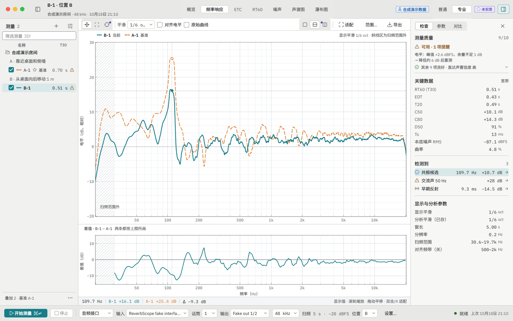 | 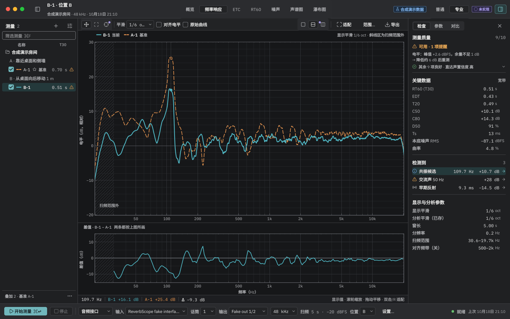 |
| 01 频率响应 · 专业 · 浅色 | 01 频率响应 · 专业 · 深色 |
| 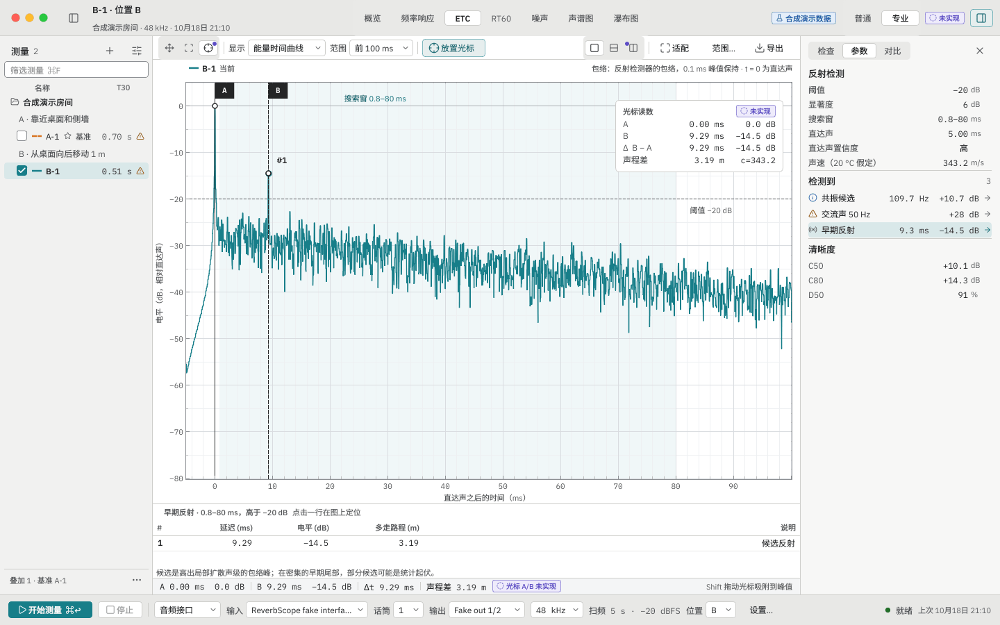 | 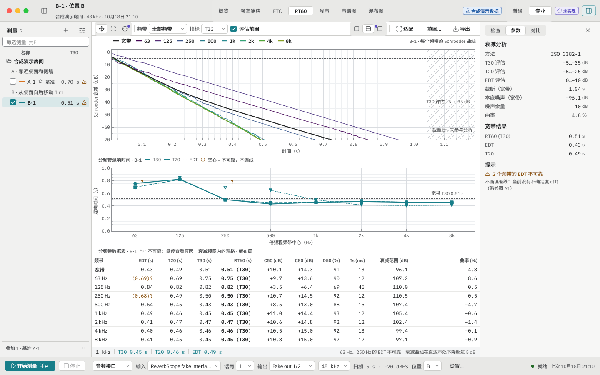 |
| 02 ETC + 光标（光标未实现） | 03 衰减 · 分频带 RT60 + 数据表 |
| 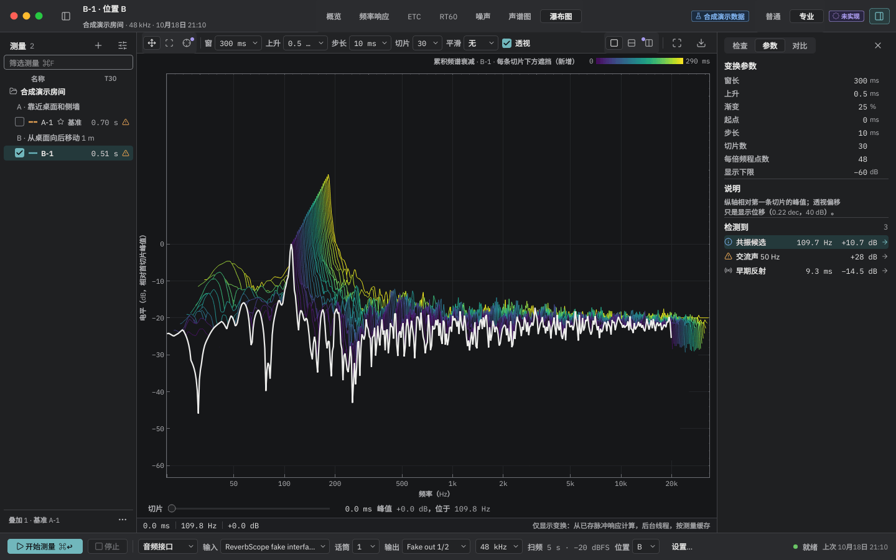 | 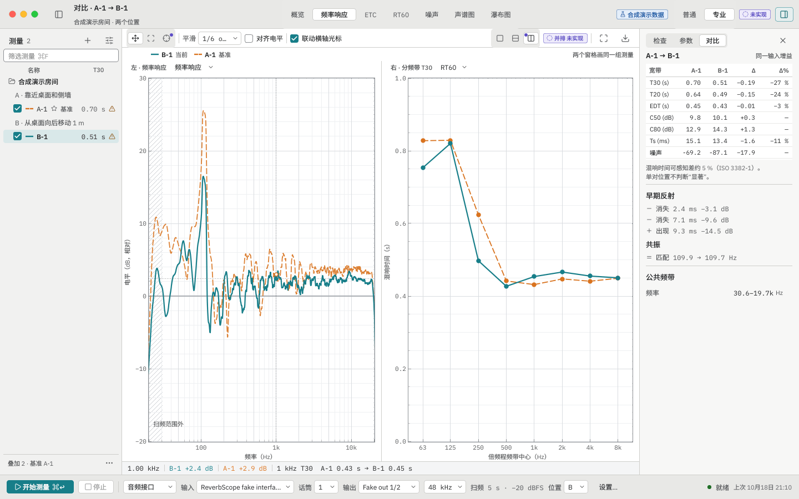 |
| 04 瀑布图 | 05 并排双图对比（并排未实现） |
| 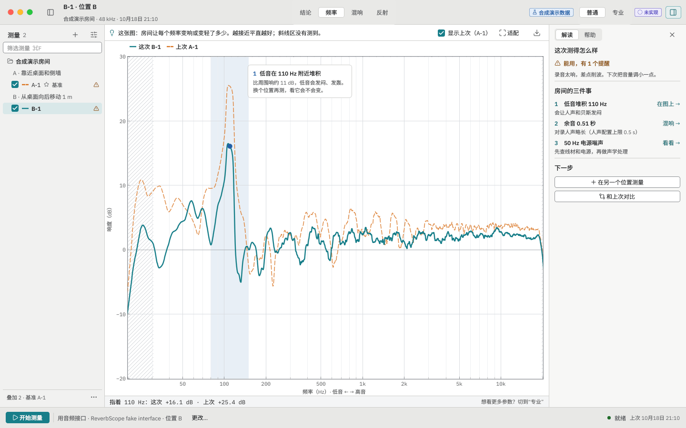 | 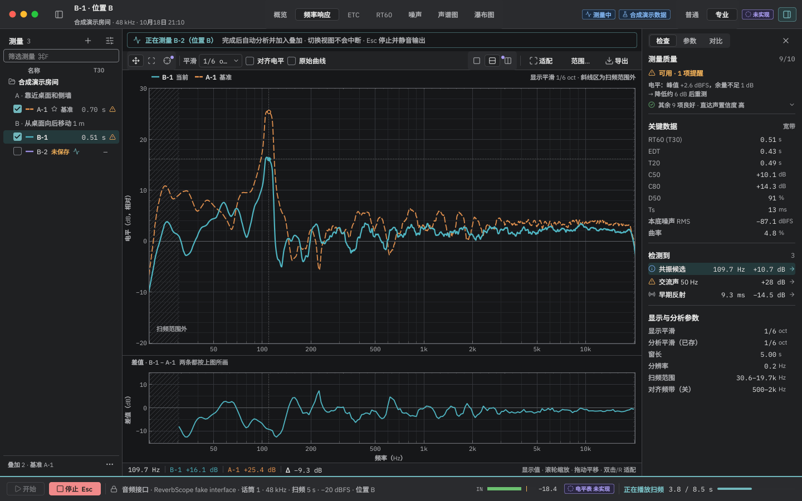 |
| 06 普通模式（未实现） | 07 测量中 |
| 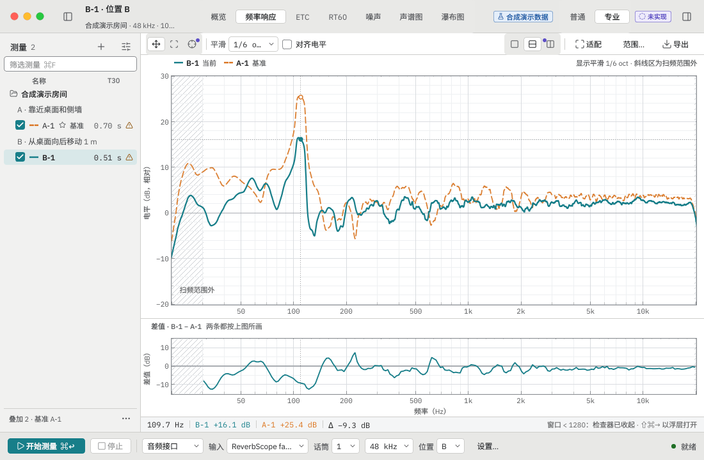 | 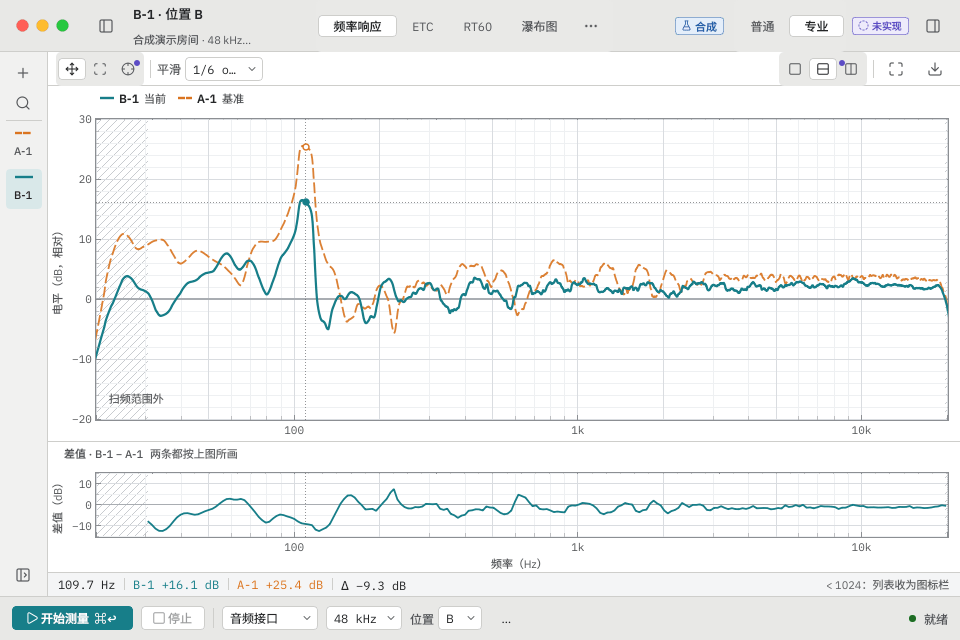 |
| 08 1100×720 检查器隐藏 | 09 960×640 列表收成图标栏 |
| 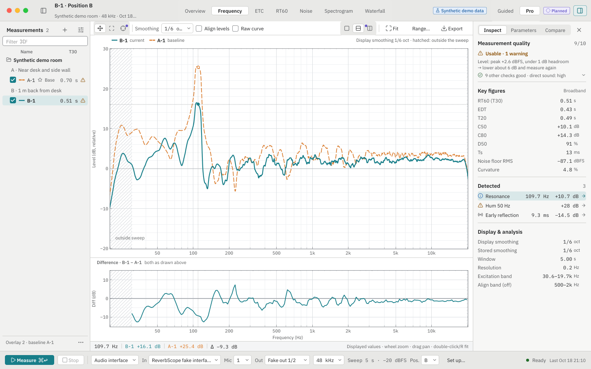 | 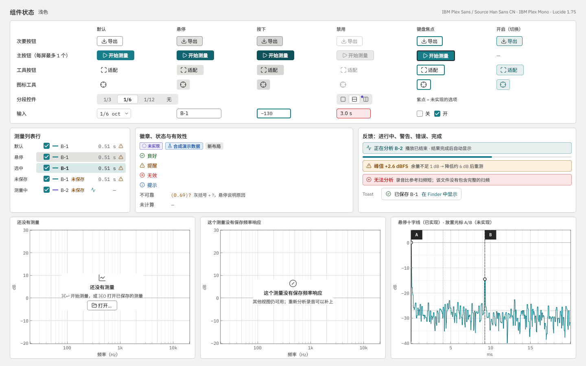 |
| 01 English · light | 10 组件状态 |
