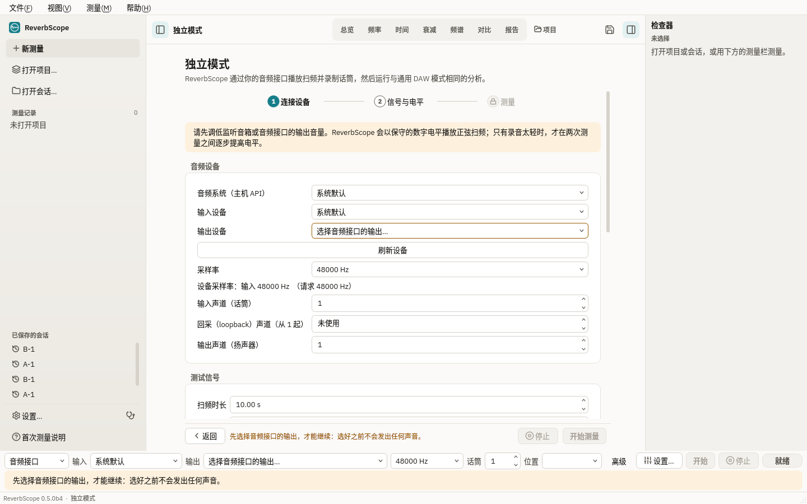
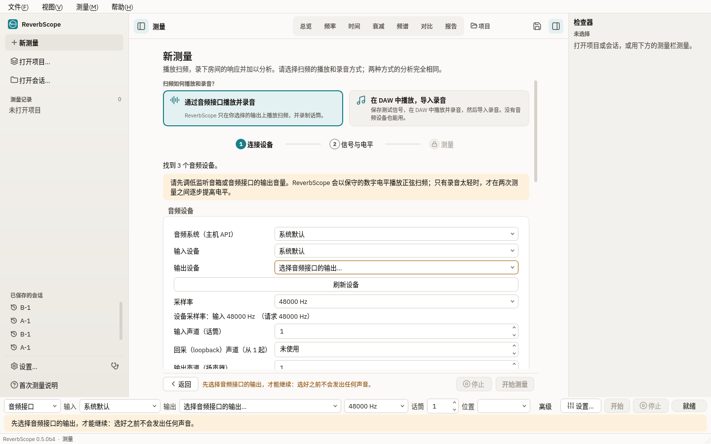
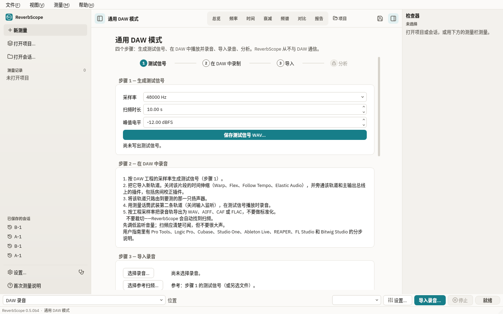
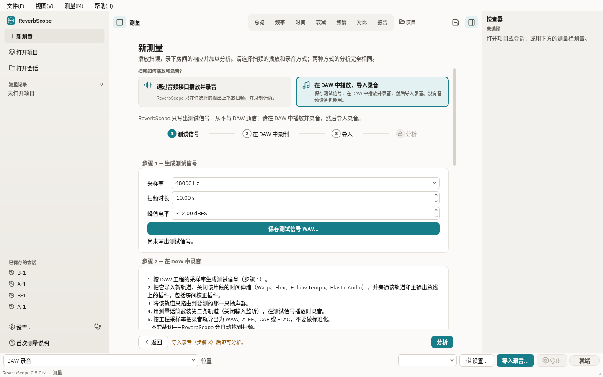
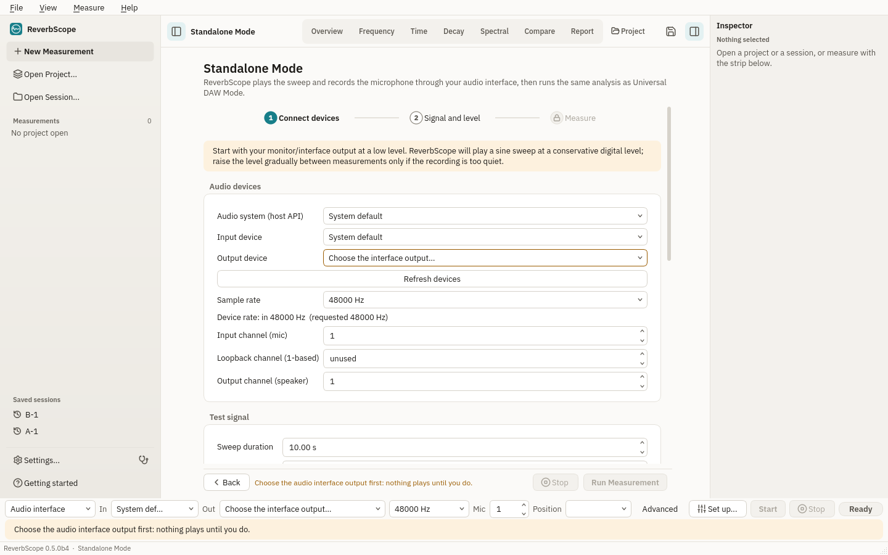
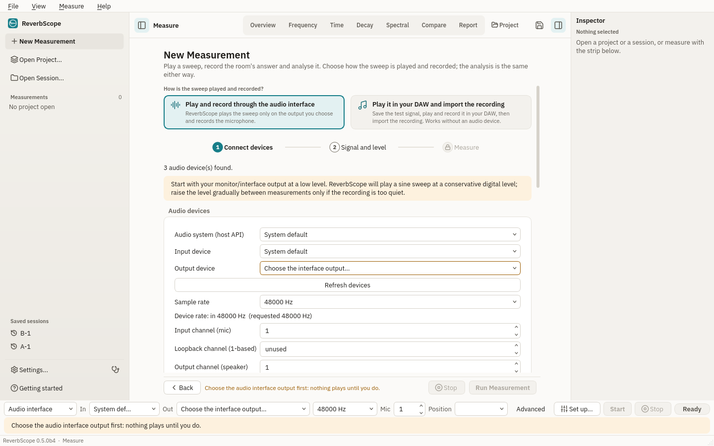
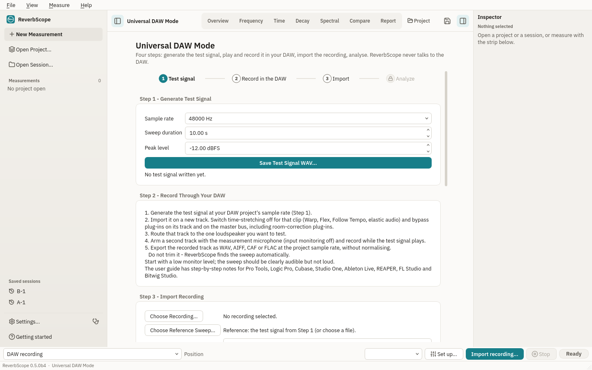
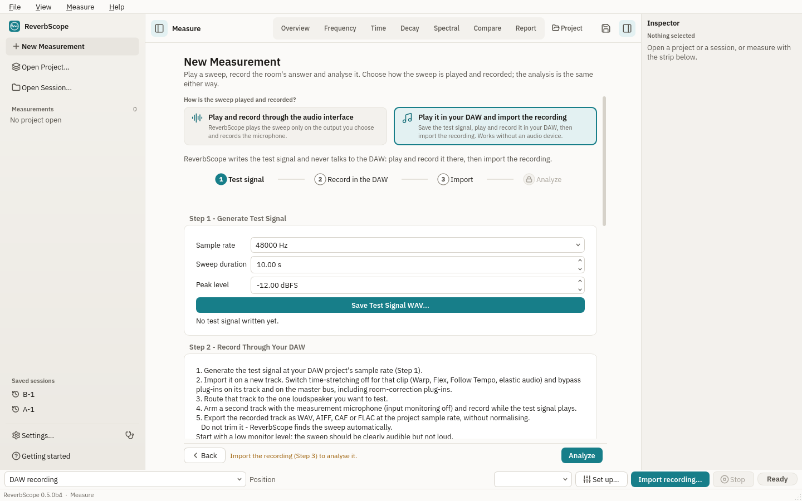
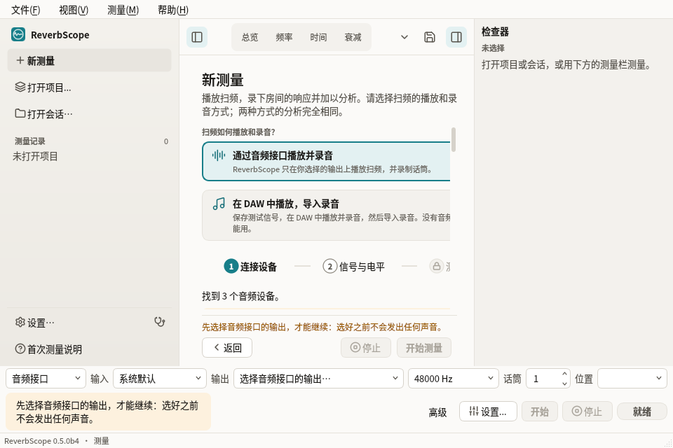
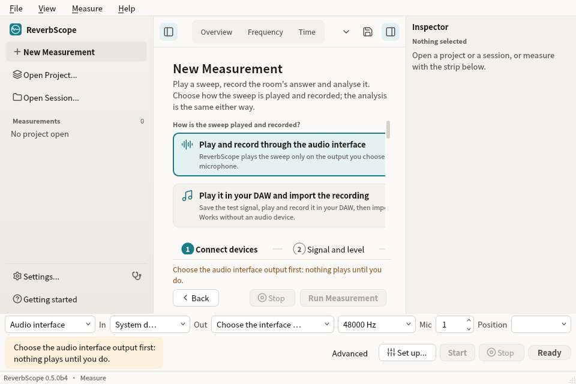

# 一个“新测量”页面 / One New Measurement page

把“通用 DAW 模式”和“独立模式”两页合成一个“新测量”页面：顶部选择扫频的播放和录音方式，下面只换不同的步骤，测量信息、分析档案和固定在底部的操作栏两种方式共用。分析结果、会话文件里的 `mode` 值、文件格式、CLI 命令和参数都没有改。

The "Universal DAW Mode" and "Standalone Mode" pages are one New Measurement
page now: a choice at the top, then only the steps that differ; the details,
profile and the pinned action bar are shared. Analysis numbers, the stored
session `mode` values, file formats and CLI commands are unchanged.

| 方式 / Way | 中文 | English | 会话 `mode` |
|---|---|---|---|
| 1 | 通过音频接口播放并录音 | Play and record through the audio interface | `standalone` |
| 2 | 在 DAW 中播放，导入录音 | Play it in your DAW and import the recording | `universal_daw` |

## 截图 / Screenshots

离屏渲染（`QT_QPA_PLATFORM=offscreen`），音频后端是 `scripts/render_gui_light_sidebar.py` 里的桩（列出笔记本扬声器、麦克风和一个双通道接口）。不是硬件测试，也不是 DAW 测试。

Offscreen renders with the stub backend of `scripts/render_gui_light_sidebar.py`
(a laptop's speakers and microphone and a two-channel interface). Not a
hardware or DAW test.

| 之前 / Before | 之后 / After |
|---|---|
|  |  |
|  |  |
|  |  |
|  |  |

960 × 640，检查器打开：两张卡片上下排列，未满足条件的原因移到按钮上方。
960 × 640 with the inspector open: the two cards stack and the reason Run is
off sits above the buttons.

